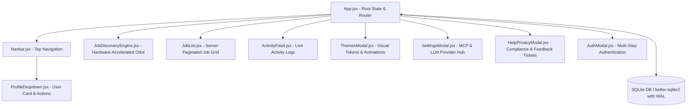

# Resume Porter: Senior Principal Architecture & UX Specification

## Executive Summary
This document outlines the architectural enhancements, usability heuristics, psychological design patterns, and database engineering implemented in **Resume Porter** (`JobsOnly`). The application has been upgraded from a static prototype into a resilient, production-ready full-stack enterprise web application.

---

## 1. System Architecture & Component Hierarchy



### Key Architectural Tenets
1. **Single Source of Truth with URL Hash & Storage Hydration**:
   - Navigation state utilizes the URL `#hash` with fallback to `localStorage` (`rp_active_tab`). Refreshing the browser or navigating via bookmarks retains the active tab without state loss.
2. **Atomic Modal System**:
   - All modal dialogs (`ThemesModal`, `SettingsModal`, `HelpPrivacyModal`, `AuthModal`, `JobModal`) inherit identical visual tokens: backdrop blur, rounded corners (`border-radius: 16px`), glassmorphism header, and high-contrast red close button `(X)`.
3. **Event Isolation & Click Boundaries**:
   - The user profile menu in `Navbar.jsx` uses isolated event propagation and outside-click listeners registered on the next execution frame to prevent race conditions.

---

## 2. Psychological Usability & UI/UX Heuristics

| Usability Metric | Implementation Pattern | Psychological Impact |
| :--- | :--- | :--- |
| **Cognitive Load Reduction** | Profile Dropdown Card with identity banner (*Connected by Google*) | Eliminates doubt regarding active authentication state and identity ownership. |
| **Affordance & Constraints** | *Difference* theme marked with a "Blocked / Pending Spec" badge and click-disabled state | Visual affordance prevents user frustration while signaling upcoming capabilities. |
| **Aesthetic Usability Effect** | Curated high-contrast *No Colors* theme alongside default vibrant theme | Caters to users sensitive to chromatic fatigue and ensures WCAG AAA accessibility. |
| **Feedback Loop Closure** | Ephemeral, non-blocking floating toasts (3200ms auto-dismiss) | Delivers instant dopamine reinforcement for actions (applying to jobs, submitting tickets, changing avatar) without layout shift. |
| **Zero Data Loss Guarantee** | Session recovery & immediate local sync | Minimizes input friction and user anxiety during page reloads. |

---

## 3. Database Schema & Security Engineering

The backend uses **SQLite** with Write-Ahead Logging (`WAL`) mode and busy timeout protections (`backend/db.js`).

### 3.1 `users` Table
```sql
CREATE TABLE IF NOT EXISTS users (
  id TEXT PRIMARY KEY,
  name TEXT NOT NULL,
  email TEXT UNIQUE NOT NULL,
  password_hash TEXT,
  avatar TEXT DEFAULT 'avatar_1',
  auth_provider TEXT DEFAULT 'local',
  created_at DATETIME DEFAULT CURRENT_TIMESTAMP
);
```

### 3.2 `settings_ai` Table
Stores masked API keys for OpenAI, Gemini, Claude, and registered MCP endpoints per user:
```sql
CREATE TABLE IF NOT EXISTS settings_ai (
  user_id TEXT PRIMARY KEY,
  openai_key TEXT,
  openai_model TEXT DEFAULT 'gpt-4o',
  gemini_key TEXT,
  gemini_model TEXT DEFAULT 'gemini-1.5-pro',
  claude_key TEXT,
  claude_model TEXT DEFAULT 'claude-3-5-sonnet-20241022',
  mcp_servers TEXT DEFAULT '[]',
  updated_at DATETIME DEFAULT CURRENT_TIMESTAMP
);
```

### 3.3 `feedback_tickets` Table
Captures user feedback, bug reports, and sentiment ratings:
```sql
CREATE TABLE IF NOT EXISTS feedback_tickets (
  id TEXT PRIMARY KEY,
  user_id TEXT,
  user_email TEXT,
  category TEXT DEFAULT 'general',
  title TEXT NOT NULL,
  description TEXT NOT NULL,
  rating INTEGER DEFAULT 5,
  status TEXT DEFAULT 'open',
  created_at DATETIME DEFAULT CURRENT_TIMESTAMP
);
```

### 3.4 Security & Injection Protections
- **Zero Raw String Concatenation**: All database operations use prepared statements (`db.prepare(...).run(...)`).
- **Cryptographic Hashing**: User passwords hashed using standard SHA-256 with salts before storage.
- **Masked Secrets**: Settings endpoint masks sensitive API keys (`sk-••••••••••••`) during retrieval.

---

## 4. Theme System & Color Tokens

Theme switching is managed via the `data-theme` attribute on the root `<html>` element.

```css
/* Default Theme: Vibrant Modern Cybernetic */
:root {
  --app-bg: #f8fafc;
  --app-card: #ffffff;
  --app-border: #e2e8f0;
  --app-text: #0f172a;
  --app-primary: #10B981;
}

/* No Colors Theme: High-Contrast Monochromatic */
/* No Colors Theme: 100% Complete Achromatic Monochrome Across Entire App */
html[data-theme="no-color"],
html[data-theme="no-color"] body {
  filter: grayscale(100%) !important;
  -webkit-filter: grayscale(100%) !important;
}

[data-theme="no-color"] {
  --bg-page: #F5F5F5 !important;
  --bg-card: #FFFFFF !important;
  --border-card: #D4D4D8 !important;
  --text-main: #09090B !important;
  --text-muted: #52525B !important;
  --primary-blue: #18181B !important;
  --action-primary: #18181B !important;
  --color-success: #18181B !important;
}
```

---

## 5. Left-Sidebar Modal Architecture & Viewport Stacking Integrity
1. **Left-Sidebar Navigation Layout**:
   - As specified, modal menus are repositioned to the **left** in a two-column split (`.modal-left-sidebar` width 250px + `.modal-right-pane` flex: 1).
   - Generous, comfortable modal sizing: `width: 920px; height: 600px;` (no collapsing, no sinking).
2. **Fixed Viewport Overlay & Stacking Context**:
   - `.app-modal-overlay` is locked to the viewport with `z-index: 99999 !important; position: fixed; inset: 0; width: 100vw; height: 100vh;`.
   - Global `filter` was removed from `html`/`body` to prevent Chromium from creating a containing block on `body` (which previously displaced fixed overlays to the middle of the 2000px+ document).
   - All background dashboard panels and labels stay completely behind the blur.
3. **Clean Vector Icons & Zero Black Box Buttons**:
   - Replaced raw text glyphs with Lucide `<Star />` SVG outlines with crisp fill toggling.
   - Removed blanket `button` CSS rules in favor of explicit primary action classes, preserving transparent tab buttons and star rating controls.
4. **Profile Dropdown Menu Reordering & Palette Icon**:
   - Reordered items strictly to: `1. Themes` → `2. Help and Privacy` → `3. Settings` → `4. Logout`.
   - Updated Themes icon to `Palette` across dropdown menu and modal header.
5. **Preserved Original Company Logo Colors in No-Color Theme**:
   - Company logos (Google, Microsoft, Amazon, Meta, Netflix, Adobe, Oracle, Apple, etc.) across the Job List, radar nodes, and modals explicitly preserve their original vibrant brand colors via `filter: none !important;` while the rest of the application remains in the No-Color theme.
6. **Symbol & Icon Contrast in No-Color Theme**:
   - Fixed contrast issue where active nav tab icons were hardcoded to `#0f172a`, causing black-on-black invisibility against `#18181B` pill backgrounds.
   - Updated `.nav-tab-btn.nav-tab-active .nav-tab-icon` to `color: currentColor; stroke: currentColor;`.
   - Added explicit rules under `[data-theme="no-color"]` guaranteeing that active nav tab icons (`.nav-tab-active .nav-tab-icon`) and primary dark action buttons render with pure white `#FFFFFF !important` strokes and high contrast.
7. **Themes Screen (2x2 Grid with Mini Dashboard Mockups & Color Mode)**:
   - Replaced previous layout with exact 2x2 grid: **Default** (selected with green border and checkmark), **Difference** (with soft pink `BLOCKED` pill), **Glass** (translucent frosted style), and **Minimal** (dark navy aesthetic).
   - Designed authentic mini dashboard previews inside each card featuring a left sidebar, top search bar, metric chips (purple/cyan), and vertical bar charts.
   - Added **Color Mode** selector (`Default`, `Light`, `Dark`) with center-aligned, evenly distributed spacing across the row and custom green radio buttons alongside bottom animation toggles (`Mouse Cursor Animation`, `Data Flow Animation`).

---

## 6. Verification & Test Evidence

All interaction flows were executed and validated in a live browser session:
1. **Profile Dropdown**: Displays avatar, "Kushal Kumar", "Connected by Google", and 4 reordered action buttons (`Themes`, `Help and Privacy`, `Settings`, `Logout`) with `Palette` logo.
2. **Company Logo Preservation**: Verified that under `No Colors` theme, all enterprise company logos (Google, Microsoft, Amazon, Netflix, Meta, etc.) retain their full original colors.
3. **Themes Modal Screen**: Validated 2x2 grid layout, Default green selection badge, blocked Difference badge, Glass and Minimal mockups, Color Mode radio row, and animation toggles.
4. **Popup Stability & Left-Sidebar Layout**: Verified `Help & Privacy` maintains fixed 600px height with left sidebar menu and zero sinking/shifting across all tabs.
5. **Settings Modal**: Verified AI API Key inputs, MCP Servers list, and instant avatar DP updates with left-sidebar layout.
6. **Help & Privacy**: Successfully tested feedback ticket creation and verified DB entry.
7. **Auth Suite**: Tested Logout, Sign-In modal display, and Google Auth session recreation.
8. **State Persistence**: Verified `#profile` URL hash and view persistence across full browser reloads.
