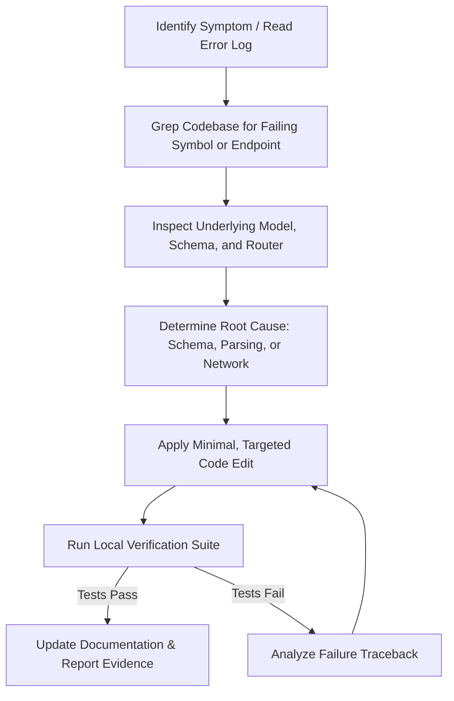

# Skill2Role: AI Coding Agent Operating Guide

**Document Purpose:** Mandatory architectural operating manual, behavioral constraints, conventions, and verification protocols for AI coding agents (Antigravity, Claude Engineer, Codex, etc.) modifying or extending the Skill2Role codebase.  
**Version:** 2.0.0  
**Effective Date:** October 2026  

---

## 1. Project Overview & Tech Stack Boundaries

Skill2Role is an AI-powered job discovery, ATS matching, resume tailoring, and autonomous application platform.

### Core Stack
- **Backend Runtime:** Python 3.12+
- **API Framework:** FastAPI (`backend/main.py`) running on `uvicorn` at port `5000`
- **Database Engine:** SQLite 3 in WAL mode (`backend/database.py`), stored at `backend/jobs.db`
- **Frontend Framework:** React 18 (JavaScript JSX) bootstrapped with Vite
- **Styling Architecture:** Pure Vanilla CSS using custom property tokens (`--rp-*`) defined in `frontend/src/index.css`. **Tailwind CSS is prohibited** unless explicitly requested by the user.
- **Port Topology:**
  - Frontend: `http://localhost:5173`
  - Backend: `http://localhost:5000` (API prefix: `/api`)

---

## 2. Repository Layout & Critical File Paths

```text
d:\JavaProjects\JobsOnly\
├── backend/
│   ├── database.py             # SQLite WAL connection manager, DDL, and migrations
│   ├── main.py                 # FastAPI app entry point, CORS, and router registration
│   ├── models.py               # Pydantic models for validation and DTOs
│   ├── test_backend.py         # Automated test suite (61 acceptance checks)
│   ├── harvest/                # ATS crawlers (Greenhouse, Ashby, Lever, RemoteOK)
│   ├── routers/                # Endpoint routers (12 modules)
│   └── services/               # Core business services (Excel, ATS, Validators)
├── frontend/
│   ├── src/
│   │   ├── App.jsx             # Main router, header, state orchestration
│   │   ├── index.css           # Design tokens, theme variables, reset
│   │   ├── components/         # Feature components (Explore, Profile, Radar, etc.)
│   │   └── context/            # AuthContext, ThemeContext, ProfileContext
│   ├── vite.config.js          # Vite build configuration with API reverse proxy
│   └── package.json            # Frontend scripts and dependencies
└── docs/                       # Canonical 15 project documentation files
```

---

## 3. Strict Execution Rules for AI Coding Agents

Every AI agent operating in this repository must uphold these 12 non-negotiable execution rules:

1. **Inspect Before Modifying:** Always use `view_file` or `grep_search` to inspect relevant code, schemas, and models before drafting changes. Never guess file contents or method signatures.
2. **Real Functionality Over Placeholders:** Implement complete, working code. Never output placeholder comments like `// TODO: Implement later` or `pass # stub`.
3. **Preserve Established Architecture:**
   - Do not replace Vanilla CSS tokens with Tailwind classes.
   - Do not replace SQLite WAL with unauthorized database servers.
   - Do not alter the 60–30–10–5 color ratio or modal UX principles.
4. **Enforce Profile Validation Gate:**
   - The 7 mandatory profile fields (`fullName`, `email`, `phone`, `city`, `primarySkill`, `selectedRoles`, `resume`) must never be bypassed in discovery or application flows.
5. **Formulas & Input Sanitization:**
   - When generating CSV or Excel exports, prepend `'` to strings starting with `=, +, -, @` to prevent formula injection.
6. **Zero Mock Data in Production Mode:**
   - Job listings, logos, and activity events must originate from database queries or live harvest scrapers. Do not inject hardcoded mock arrays into frontend components.
7. **Never Fabricate Verification Results:**
   - Never claim tests passed or builds succeeded without executing the command and inspecting the stdout/stderr.
8. **Run Verification After Every Change:**
   - Backend edits: Execute `python test_backend.py` inside `backend/`.
   - Frontend edits: Execute `npm run build` inside `frontend/`.
9. **Never Bypass Security Controls:**
   - Do not disable CORS, remove password hashing, or permit unauthorized SQL string concatenation.
10. **Preserve Existing Documentation & Comments:**
    - Do not wipe existing architectural comments or docstrings unless correcting obsolete technical facts.
11. **Maintain Cross-Document Consistency:**
    - When modifying an API endpoint or database column, immediately update the corresponding docs in `docs/api.md`, `docs/database.md`, and `docs/architecture.md`.
12. **Honest Blocker Reporting:**
    - If a task cannot be completed due to missing third-party credentials (e.g. LinkedIn session cookies, OpenAI keys), clearly document the blocker rather than creating simulated fake success.

---

## 4. Coding & Design Conventions

### 4.1 Backend (Python / FastAPI)
- **Module Imports:** Wrap imports in `try/except (ImportError, ValueError)` blocks to support running via `python main.py` directly from `backend/` or as a top-level package.
- **Database Access:** Always use the context manager `with get_db() as conn:`. Never leave open connections hanging.
- **Timestamps:** Store all timestamps as integer millisecond Unix timestamps (`int(time.time() * 1000)`).
- **Type Annotations:** Use Pydantic models in `backend/models.py` for request bodies.
- **Responses:** Always return JSON-serializable dictionaries or Pydantic schemas.

### 4.2 Frontend (React / JSX / CSS)
- **CSS Custom Properties:** All colors, radiuses, and shadows must use the CSS tokens defined in `frontend/src/index.css`:
  - Surfaces: `var(--rp-bg-card)`, `var(--rp-bg-deep)`
  - Text: `var(--rp-text-primary)`, `var(--rp-text-secondary)`, `var(--rp-text-muted)`
  - Accent: `var(--rp-accent-teal)`, `var(--rp-accent-cyan)`
  - Borders: `var(--rp-border)`
- **Themes & Modes:** Ensure components look pixel-perfect in both supported themes (`default` and `minimal`) and both modes (`dark` and `light`) with high-contrast input, textarea, and action button readability. Glass and Difference themes are decommissioned.
- **Modals:** All dialogs and popups must use the universal modal container (`.rp-modal-overlay` and `.rp-modal-card`) with backdrop blur and escape key handling.

---

## 5. Development & Verification Commands

### 5.1 Starting Development Servers
- **Backend Server:**
  ```powershell
  cd d:\JavaProjects\JobsOnly\backend
  python main.py
  ```
  Runs FastAPI on `http://127.0.0.1:5000` with hot-reload support.

- **Frontend Server:**
  ```powershell
  cd d:\JavaProjects\JobsOnly\frontend
  npm run dev
  ```
  Runs Vite dev server on `http://localhost:5173`.

### 5.2 Verification Suite
- **Run Backend Acceptance Tests:**
  ```powershell
  cd d:\JavaProjects\JobsOnly\backend
  python test_backend.py
  ```
  *Expected Result:* 61 passed checks across auth, profile gates, Excel export/import, search filters, and database WAL operations.

- **Run Frontend Production Build:**
  ```powershell
  cd d:\JavaProjects\JobsOnly\frontend
  npm run build
  ```
  *Expected Result:* Clean Vite bundle compilation in under 2 seconds with zero syntax or JSX errors.

---

## 6. Debugging Workflow for Agents

When resolving bugs or test failures, AI agents must follow this sequential loop:



1. **Step 1:** Read the terminal log or exception traceback completely.
2. **Step 2:** Locate the exact file and line number where the exception occurred.
3. **Step 3:** Formulate a hypothesis and test it against existing database constraints and Pydantic rules.
4. **Step 4:** Perform the fix using single or multi-chunk file replacement.
5. **Step 5:** Rerun `python test_backend.py` and `npm run build`. Never report success without running verification.

---

## 7. Stage Authorization & Transition Boundary

Skill2Role is developed under strict staged governance:
- **Stage 1 (Foundation, Authentication, Profiles, Explorer):** Complete and verified.
- **Stage 2 (Target Role Matching, ATS Score Optimization, Automation):** **Requires explicit authorization from the user.** AI agents must not implement Stage 2 pipelines or auto-apply submission engines until authorized.
- **Stage 3 to 5:** Strictly planned roadmaps.
