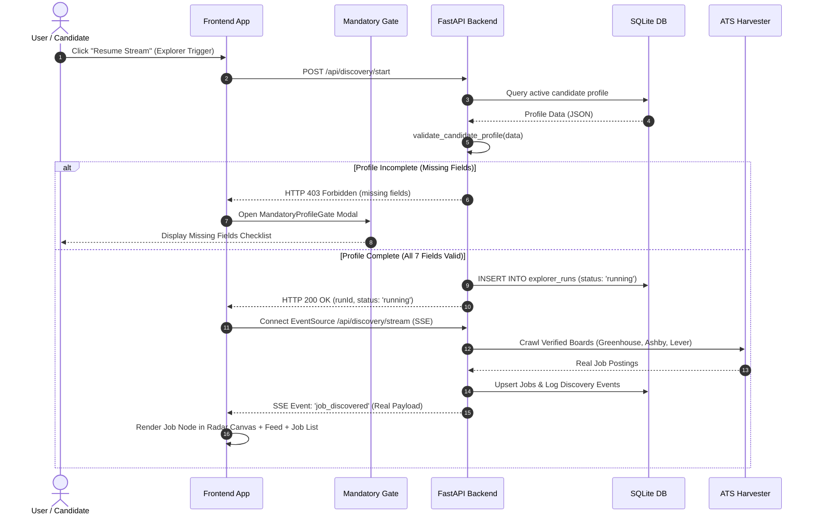

# System Architecture Specification

**Product:** Skill2Role (AI-Powered Job Discovery, Tailoring & Application Platform)  
**Document Version:** 1.0.0  
**Status:** Verified Architecture Reference  
**Authors:** Senior Principal Software Engineer, Enterprise Systems Architect  

---

## 1. System Context & High-Level Architecture

Skill2Role is designed as a modular, decoupled web application composed of a reactive single-page frontend, a high-throughput asynchronous Python FastAPI backend, a transactional SQLite database running in Write-Ahead Logging (`WAL`) mode, and a multi-source job harvesting/search integration engine.

```mermaid
graph TB
    subgraph Client Tier [Browser Single Page Application]
        UI[React 18 Shell - App.jsx]
        Radar[Radar Orbit - JobDiscoveryEngine.jsx]
        JobList[Job List & Table - JobList.jsx]
        Feed[Activity Feed - ActivityFeed.jsx]
        Gate[Mandatory Profile Gate]
        State[Toast / Session State]
    end

    subgraph Server Tier [FastAPI Asynchronous Backend :5000]
        Router[FastAPI API Router]
        AuthSvc[Auth Router - JWT HS256]
        ProfileSvc[Profile Router & Validator]
        KwEngine[Anchored Keyword Generator]
        DiscoverySvc[Discovery & SSE Stream Manager]
        HarvestSvc[ATS Harvester Orchestrator]
        ExcelSvc[Excel/CSV Streaming & Import Service]
        AutoSvc[Automation Pipeline Router]
    end

    subgraph Data Tier [Persistence Layer]
        SQLite[(SQLite 3 - WAL Mode)]
        Filesystem[(Local File Storage - Resumes & Uploads)]
    end

    subgraph External Providers & Connectors
        GH[Greenhouse Public ATS Feeds]
        Ashby[Ashby Public ATS Feeds]
        Lever[Lever Public Postings Feeds]
        RemoteOK[RemoteOK Public Feed]
        Remotive[Remotive Public Feed]
        LI[LinkedIn Connector - Auth Protected]
        IND[Indeed Connector - Cloudflare Protected]
        LLM[External AI Models - OpenAI / Claude / Gemini / Ollama]
    end

    UI -->|HTTP / JSON| Router
    Radar -->|SSE Stream /discovery/stream| Router
    Router --> AuthSvc
    Router --> ProfileSvc
    Router --> KwEngine
    Router --> DiscoverySvc
    Router --> HarvestSvc
    Router --> ExcelSvc
    Router --> AutoSvc

    ProfileSvc --> SQLite
    DiscoverySvc --> SQLite
    ExcelSvc --> SQLite
    AutoSvc --> SQLite
    ProfileSvc --> Filesystem

    HarvestSvc -->|HTTP REST| GH
    HarvestSvc -->|HTTP REST| Ashby
    HarvestSvc -->|HTTP REST| Lever
    HarvestSvc -->|HTTP REST| RemoteOK
    HarvestSvc -->|HTTP REST| Remotive
    DiscoverySvc -.->|Status Check| LI
    DiscoverySvc -.->|Status Check| IND
    KwEngine -.->|REST / Deterministic Fallback| LLM
```



---

## 2. Layered Architecture & Separation of Concerns

### 2.1 Frontend Tier (`frontend/src/`)
- **Presentation Layer (`components/`):** Viewport-locked, theme-adaptive components.
  - `Navbar.jsx`: Top navigation, candidate profile indicator, universal actions.
  - `JobDiscoveryEngine.jsx`: Hardware-accelerated 2D Canvas Radar orbit with manual "Resume Stream" trigger.
  - `JobList.jsx`: Virtualized/paginated job listing with 5-day historical navigation, filter dropdowns, and export triggers.
  - `ActivityFeed.jsx`: Real-time audit log of discovered, applied, and imported opportunities.
  - `ProfileView.jsx`: Candidate persona management, structured resume attributes, and role keywords table.
- **Service Layer (`services/api.js`):** Unified REST and SSE client handling authentication headers, token renewal, and typed API responses.
- **Styling Architecture (`styles/`):** Pure CSS design token system (`tokens/colors.css`, `themes/`, `foundations/`) completely decoupled from layout markup.

### 2.2 Backend Tier (`backend/`)
- **API Routing Layer (`routers/`):** REST endpoints mapping HTTP requests to business logic with typed Pydantic validation.
- **Core Services Layer (`services/`):**
  - `profile_validator.py`: Enforces mandatory profile completion before unlocking Explorer.
  - `keyword_generator.py`: Enforces primary skill anchoring and deterministic fallback synthesis.
  - `platform_searcher.py`: Modular status reporting and connector orchestration.
  - `excel_service.py`: Complete dataset streaming with CSV formula injection sanitization.
- **Harvester Engine (`harvest/`):** Direct ATS board crawlers (`greenhouse.py`, `ashby.py`, `lever.py`, `remote_boards.py`) parsing live job feeds.
- **Data Access Layer (`database.py`):** Connection pooling, schema migrations, WAL initialization, and atomic transaction execution.

---

## 3. Core Request Lifecycle & Data Flows

### 3.1 Mandatory Profile Completion & Discovery Lifecycle



### 3.2 Candidate Persona Switching Flow
1. User selects a different candidate persona from the `CandidateProfileSwitcher` in the Navbar.
2. Frontend calls `POST /api/profiles/{id}/activate`.
3. Backend executes atomic transaction:
   - Sets `is_active = 0` for all candidate profiles.
   - Sets `is_active = 1` for designated profile.
   - Halts and cancels any active `explorer_runs` for previous profiles to isolate data.
   - Synchronizes candidate resume data to active session.
4. Response returns updated `activeProfileId`. Frontend invalidates cache and triggers `loadJobsPage(1)`.

---

## 4. Concurrency, Background Jobs & Real-Time Streaming

### 4.1 Server-Sent Events (SSE) Stream
- **Endpoint:** `GET /api/discovery/stream`
- **Mechanism:** Asynchronous Python generator (`async def event_generator()`) utilizing FastAPI's `StreamingResponse(media_type="text/event-stream")`.
- **Throttling & Buffer:** Frontend batches incoming events using requestAnimationFrame and short buffer intervals (250ms) to ensure smooth 60 FPS UI updates without layout thrashing.

### 4.2 Database Concurrency (SQLite WAL)
- Enabled via:
  ```python
  PRAGMA journal_mode = WAL;
  PRAGMA synchronous = NORMAL;
  PRAGMA busy_timeout = 10000;
  ```
- **Benefit:** Writers do not block readers, and readers do not block writers. Background crawlers write harvested jobs simultaneously while users query paginated job lists with zero lock contention.

---

## 5. Security & Isolation Architecture

### 5.1 Account vs Candidate Identity Separation
- **Account Identity (`users`):** Represents the login credentials (`id`, `email`, `password_hash`, `auth_provider`).
- **Candidate Identity (`candidate_profiles`):** Represents professional personas (`name`, `primarySkill`, `resume`, `preferences`).
- **Enforcement:** One account can own multiple candidate profiles. The persistent UI label displays the candidate profile name, never exposing account metadata.

### 5.2 Formula Injection Protection
Spreadsheet software (Microsoft Excel, Google Sheets, LibreOffice Calc) treats cells starting with `=`, `+`, `-`, `@`, `\t`, or `\r` as executable formula expressions (CSV Injection / DDE attack).
- **Sanitization Strategy:** The `sanitize_csv_cell()` service checks all text fields and prepends a single quote (`'`) to any dangerous character, preventing spreadsheet command execution while preserving human readability.

---

## 6. Observability, Logging & Error Handling

- **Actionable Diagnostic Logging:** Configured via Python's standard `logging` with module prefixes (`skill2role.discovery`, `skill2role.harvest`).
- **Secret Redaction:** Logs explicitly exclude authorization headers, JWT tokens, session cookies, and personal identity strings.
- **Client-Side Error Boundaries:** All lazy-loaded views are wrapped with `<ErrorBoundary>` components to prevent transient rendering exceptions from crashing the application shell.
