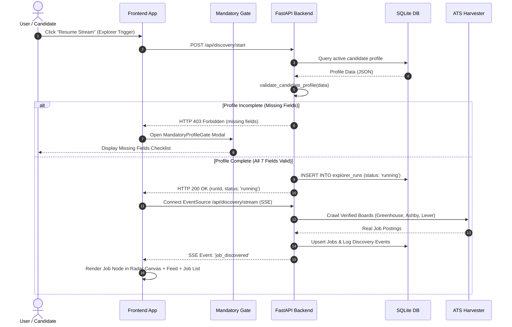
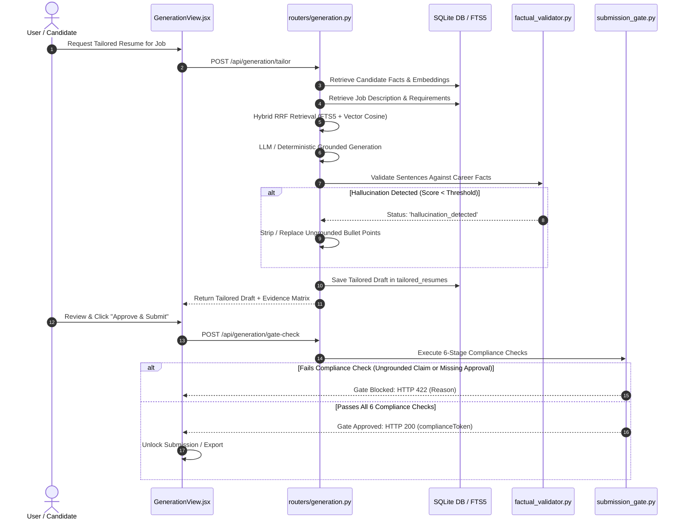

# Skill2Role: System Architecture Specification

**Product:** Skill2Role (AI-Powered Job Discovery, Tailoring & Application Platform)  
**Document Version:** 2.0.0 (Audited Repository State)  
**Audit & Review Date:** October 21, 2026  
**Auditor:** Senior Principal Software Architect & Technical Lead  
**Status:** Verified Architecture Reference  

---

> [!NOTE]
> This architecture specification accurately reflects the audited state of the repository, including active Stage 1 features, Stage 2 local RAG pipeline modules, and verified database schemas.

---

## 1. System Context & High-Level Architecture

Skill2Role is designed as a modular, decoupled web application composed of a reactive single-page frontend, a high-throughput asynchronous Python FastAPI backend, a transactional SQLite database running in Write-Ahead Logging (`WAL`) mode, and a multi-source job harvesting and local RAG tailoring engine.

```mermaid
graph TB
    subgraph Client Tier [Browser Single Page Application - React 19.2 + Vite]
        UI[React Shell - App.jsx]
        Radar[Radar Orbit - JobDiscoveryEngine.jsx]
        JobList[Job List & Virtual Table - JobList.jsx]
        Feed[Activity Feed - ActivityFeed.jsx]
        Profile[Profile & Personas - ProfileView.jsx]
        GenUI[Tailoring Studio - GenerationView.jsx]
        AutoUI[Automation Queue - AutomationView.jsx]
        ToolsUI[Career Tools - ToolsView.jsx]
        Gate[Mandatory Profile Gate]
        State[Toast / Session State / api.js]
    end

    subgraph Server Tier [FastAPI Asynchronous Backend :5000]
        Router[FastAPI API Router - main.py]
        AuthRouter[Auth & Login Routers - main.py & routers/login.py]
        ProfileRouter[Profile Router & Validator - routers/profile.py]
        JobsRouter[Jobs Query & History Router - routers/jobs.py]
        DiscoveryRouter[Discovery & SSE Stream Manager - routers/discovery.py]
        AutoRouter[Automation Pipeline Router - routers/automation.py]
        GenRouter[Generation & RAG Router - routers/generation.py]
        
        subgraph Stage 2 Local RAG Pipeline [backend/services/]
            DocParser[Document Parser - document_parser.py]
            Chunker[Chunking Service - chunking_service.py]
            FactSvc[Career Facts Extractor - career_facts_service.py]
            Embedder[384-Dim Token Hash Embedder - embedding_service.py]
            Retriever[Hybrid RRF Retriever - hybrid_retriever.py]
            Analyzer[Job Description Analyzer - job_analyzer.py]
            Generator[Grounded Generator - gemini_generator.py]
            Validator[Sentence Factual Validator - factual_validator.py]
            Gatekeeper[Compliance Submission Gate - submission_gate.py]
            Exporter[Multi-Format Exporter - resume_exporter.py]
        end
        
        HarvestSvc[ATS Harvester Orchestrator - backend/harvest/]
        ExcelSvc[Excel/CSV Streaming Service - excel_service.py]
    end

    subgraph Data Tier [Persistence Layer - jobs.db WAL Mode]
        SQLite[(SQLite 3 - Core Entity Tables)]
        FTS5[(SQLite FTS5 - document_chunks_fts)]
        EmbedDB[(SQLite BLOBs - chunk_embeddings)]
        Filesystem[(Local File Storage - Resumes & Uploads)]
    end

    subgraph External ATS Providers & AI Models
        GH[Greenhouse Public ATS Feeds]
        Ashby[Ashby Public ATS Feeds]
        Lever[Lever Public Postings Feeds]
        RemoteOK[RemoteOK Public Feed]
        Naukri[Naukri Feed - Staged for Repair]
        LI[LinkedIn Guest - Missing bs4 Dependency]
        Gemini[Google Gemini 1.5/2.0 API - Grounded Tailoring]
        OpenAI[OpenAI / Claude API - Fallback Providers]
    end

    UI -->|HTTP / JSON| Router
    Radar -->|SSE Stream /api/discovery/stream| DiscoveryRouter
    Router --> AuthRouter
    Router --> ProfileRouter
    Router --> JobsRouter
    Router --> DiscoveryRouter
    Router --> AutoRouter
    Router --> GenRouter

    GenRouter --> DocParser
    GenRouter --> Chunker
    GenRouter --> FactSvc
    GenRouter --> Embedder
    GenRouter --> Retriever
    GenRouter --> Analyzer
    GenRouter --> Generator
    GenRouter --> Validator
    GenRouter --> Gatekeeper
    GenRouter --> Exporter

    ProfileRouter --> SQLite
    JobsRouter --> SQLite
    DiscoveryRouter --> SQLite
    AutoRouter --> SQLite
    GenRouter --> SQLite
    GenRouter --> FTS5
    GenRouter --> EmbedDB
    ProfileRouter --> Filesystem

    HarvestSvc -->|HTTP REST| GH
    HarvestSvc -->|HTTP REST| Ashby
    HarvestSvc -->|HTTP REST| Lever
    HarvestSvc -->|HTTP REST| RemoteOK
    Generator -.->|External API Call| Gemini
    Generator -.->|Fallback API Call| OpenAI
```



---

## 2. Layered Architecture & Module Distribution

### 2.1 Frontend Tier (`frontend/src/`)
- **Runtime Environment:** React 19.2.0, Vite 6/8, pure CSS custom property design token system.
- **Presentation Layer (`components/`):** Viewport-locked, theme-adaptive modular components.
  - `Navbar.jsx`: Top navigation, active candidate profile indicator, universal actions, theme selector.
  - `JobDiscoveryEngine.jsx`: Hardware-accelerated 2D Canvas Radar orbit with live SSE discovery ingestion.
  - `JobList.jsx`: Virtualized/paginated job listing with 5-day historical navigation, filter dropdowns, and export triggers.
  - `ActivityFeed.jsx`: Real-time audit log of discovered, applied, and imported opportunities.
  - `ProfileView.jsx`: Candidate persona management, structured resume attributes, 7-field gate indicator.
  - `GenerationView.jsx`: Resume ingestion, JD keyword gap analysis, tailored preview, export formatting.
  - `AutomationView.jsx`: Auto-apply pipeline status, job queue, execution logs (currently simulation mode).
  - `ToolsView.jsx`: ATS readiness checker and JD skill analyzer (currently static mockups).
- **Service Layer (`services/api.js`):** Unified REST and SSE client handling authentication headers, token storage, and API responses. *(Note: Contains fallback mock traps flagged for remediation).*
- **Design Token System (`styles/`):** Pure CSS design token system (`tokens/colors.css`, `themes/`, `foundations/`) decoupled from layout markup, supporting 2 streamlined themes (`default`, `minimal`) across Light and Dark modes with universal contrast guarantees.

### 2.2 Backend Tier (`backend/`)
- **API Routing Layer (`routers/`):** REST endpoints mapping HTTP requests to business logic with typed Pydantic schemas.
  - `routers/jobs.py`: Job listings, 5-day historical offset aggregation, bookmark toggling, application toggles.
  - `routers/profile.py`: Profile updates, persona management, 7-field validation, keyword expansion.
  - `routers/discovery.py`: Radar scan triggers, SSE live discovery stream, ATS connector health.
  - `routers/automation.py`: Pipeline listing, toggle active state, supervised auto-apply queue.
  - `routers/generation.py`: Complete 10-endpoint RAG pipeline (ingest, analyze, retrieve, validate, export, gate).
  - `routers/login.py`: Secondary auth router providing user sign-in, registration, and Google OAuth mocks.
- **Stage 2 Local RAG Services Layer (`services/`):**
  - `document_parser.py`: PDF, DOCX, and TXT parsing into structured text sections.
  - `chunking_service.py`: Sliding window token chunking with paragraph boundary preservation.
  - `career_facts_service.py`: Extraction of 6 factual categories (skills, metrics, titles, companies, education, certifications).
  - `embedding_service.py`: Local deterministic 384-dimensional hashed TF-IDF vector embeddings stored as BLOBs.
  - `hybrid_retriever.py`: Reciprocal Rank Fusion (RRF) combining SQLite FTS5 lexical ranking with vector cosine similarity.
  - `job_analyzer.py`: JD requirement parsing, keyword extraction, and skill categorization.
  - `gemini_generator.py`: Grounded resume tailoring with factual injection prompts and deterministic fallbacks.
  - `factual_validator.py`: Sentence-level NLI and token overlap hallucination detection.
  - `submission_gate.py`: 6-stage deterministic compliance gate blocking unverified or ungrounded submissions.
  - `resume_exporter.py`: Production-grade document formatting for HTML, Markdown, Plain Text, DOCX, and JSON-LD.
- **Harvester Engine (`harvest/`):** Direct ATS board crawlers (`greenhouse.py`, `ashby.py`, `lever.py`, `remote_boards.py`, `naukri_connector.py`, `linkedin_guest.py`).
- **Data Access Layer (`database.py`):** SQLite connection management, schema initialization, idempotent migrations, WAL mode initialization.

---

## 3. Data Flow & Core Request Lifecycles

### 3.1 Mandatory Profile Gate & Discovery Flow


### 3.2 Grounded Resume Tailoring & Submission Gate Lifecycle


---

## 4. Concurrency, Background Jobs & Real-Time Streaming

### 4.1 Server-Sent Events (SSE) Stream
- **Endpoint:** `GET /api/discovery/stream`
- **Implementation:** Asynchronous Python generator (`async def event_generator()`) utilizing FastAPI's `StreamingResponse(media_type="text/event-stream")`.
- **Client Handling:** Frontend batches incoming events using `requestAnimationFrame` to ensure smooth 60 FPS UI rendering without layout thrashing.

### 4.2 SQLite WAL Concurrency
- Configured via connection pragmas:
  ```sql
  PRAGMA journal_mode = WAL;
  PRAGMA synchronous = NORMAL;
  PRAGMA busy_timeout = 5000;
  ```
- **Operational Reality:** Writers do not block readers, and readers do not block writers. Background crawlers write harvested jobs simultaneously while users query paginated job lists with zero lock contention.

---

## 5. Security & Isolation Architecture

### 5.1 Current Authentication State & Known Vulnerabilities
- **Current State:** Passwords hashed using static-salted SHA-256 (`hashlib.sha256((salt + password).encode()).hexdigest()`). Session tokens emitted as plain strings (`tok_<user_id>`).
- **Required Remediation (Pre-Release):** Upgrade to PBKDF2 (`hashlib.pbkdf2_hmac` with 100,000 iterations and per-user cryptographic salt) or `bcrypt`. Replace plain string tokens with cryptographically signed HS256 JWT tokens with explicit expiration claims (`exp`).

### 5.2 Account vs Candidate Identity Separation
- **Account Identity (`users`):** Authentication credentials (`id`, `email`, `password_hash`, `auth_provider`).
- **Candidate Identity (`candidate_profiles`):** Professional personas (`name`, `primarySkill`, `resume`, `preferences`).
- **Rule:** One account owns multiple candidate personas. The UI displays the active candidate persona name, never exposing account login credentials.

### 5.3 Spreadsheet Formula Injection Protection
- The `excel_service.py` sanitization logic checks all text cells in exported spreadsheets. If a cell begins with dangerous formula prefixes (`=`, `+`, `-`, `@`, `\t`, `\r`), it is prepended with a single quote (`'`), neutralizing CSV Injection (DDE) attacks while preserving human readability.

---

## 6. Observability, Logging & Error Boundaries

- **Logging:** Structured logging configured via Python standard `logging` with module prefixes (`skill2role.discovery`, `skill2role.generation`, `skill2role.harvest`).
- **Secret Redaction:** Logs explicitly omit authorization headers, passwords, and personal identity strings.
- **Frontend Error Boundaries:** Lazy-loaded views are wrapped with `<ErrorBoundary>` components to prevent transient rendering exceptions from crashing the application shell.
