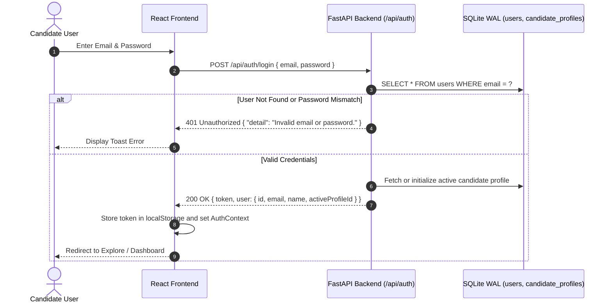

# Skill2Role: Authentication & Security Architecture

**Document Purpose:** Complete specification of identity verification, authorization policies, cryptographic operations, transport security, threat modeling, and defensive controls in the Skill2Role platform.  
**System Version:** 2.0.0 (Stage 1 Implemented & Verified)  
**Last Security Review:** October 2026  

---

## 1. Verified Security Controls vs. Planned Hardening

| Control Area | Implemented & Verified (Stage 1) | Planned Hardening (Stages 2–5) |
| :--- | :--- | :--- |
| **Password Storage** | Salted SHA-256 (`hash_password` in `backend/routers/auth.py`) with 6-char minimum constraint. | Migration to Argon2id / bcrypt with work factor 12. |
| **Session & Token** | Bearer authorization token format (`tok_{user_id}`) passed via HTTP `Authorization: Bearer <token>`. | Cryptographically signed RS256 JWT with short expiry (15m) and HTTP-only refresh cookies. |
| **Social Sign-In** | Google OAuth profile mapping and idempotent account creation. | Google Identity Services JWT validation on backend via `google-auth` library. |
| **Profile Ownership** | Personas and job records tagged with `user_id` and `profile_id`. | Strict multi-tenant Role-Based Access Control (RBAC). |
| **SQL Injection** | Parameterized queries with SQLite `?` placeholders across 100% of database interactions. | Static analysis checks (Bandit / Semgrep) in CI/CD pipeline. |
| **CSV Formula Injection**| Automatic sanitization prepending `'` to values starting with `=, +, -, @` in `backend/services/excel_service.py`. | Strict character whitelist encoding. |
| **File Upload Security** | Content-Type checking and size validation on resume PDF/DOCX uploads. | ClamAV antivirus scanning and sandboxed PDF parsing worker. |
| **CORS Policy** | Configured via FastAPI `CORSMiddleware` with allowed origins. | Restrict origins in production to designated frontend domain. |

---

## 2. Authentication Lifecycle & Account Management

### 2.1 User Registration (`POST /api/auth/register`)
1. **Email Normalization:** Converts email to lowercase and strips surrounding whitespace.
2. **Regex Validation:** Enforces RFC 5322 compliant email format: `^[a-zA-Z0-9_.+-]+@[a-zA-Z0-9-]+\.[a-zA-Z0-9-.]+$`.
3. **Password Constraints:** Enforces minimum 6 characters.
4. **Collision Check:** Verifies email uniqueness in SQLite `users` table; returns `409 Conflict` if existing.
5. **Initial Persona Provisioning:** Atomically creates an initial `candidate_profiles` entry for the user.

### 2.2 Google Social Authentication (`POST /api/auth/google`)
- Implements idempotent authentication: If the email exists, it links and logs the user in; if it does not exist, an account is automatically provisioned with `auth_provider = 'google'`.

---

## 3. Mandatory Profile Validation Gate (Security Perspective)

A distinctive security and anti-abuse feature in Skill2Role is the **7-Field Mandatory Profile Gate**. This mechanism prevents the discovery engine and auto-apply automation from generating untargeted, low-quality submissions.

### The 7 Mandatory Checks:
1. `fullName`: Non-empty candidate identity.
2. `email`: Valid contact email.
3. `phone`: Contact telephone number.
4. `city`: Geographical anchor.
5. `primarySkill`: Core domain qualification.
6. `selectedRoles`: Minimum 1 target job title.
7. `resume`: Uploaded resume payload.

If any field is missing, the backend rejects scan initiation requests with `400 Bad Request` and returns the exact missing array (`{"isComplete": false, "missingFields": [...]}`).

---

## 4. Threat Model & Defensive Mitigations

### 4.1 SQL Injection (SQLi)
- **Threat:** Malicious input strings in search parameters attempting to manipulate SQLite queries.
- **Defense:** Strict parameterized queries. Zero instances of raw string interpolation (`f"SELECT ... WHERE x = {input}"`) exist in `backend/database.py` or any router. Dynamic filter clauses construct `where_clauses.append("col = ?")` with matching parameter arrays.

### 4.2 CSV / Excel Formula Injection (CSV Injection)
- **Threat:** An attacker inputs malicious spreadsheet formulas (e.g., `=CMD|' /C calc'!A0` or `@SUM(...)`) into a job title or company name. When exported to CSV and opened in Microsoft Excel, the spreadsheet executes the payload.
- **Defense:** In `backend/services/excel_service.py`, the `sanitize_csv_cell()` helper inspects string cells. If the first character is `=`, `+`, `-`, or `@`, it prepends a single quote (`'`), neutralizing formula execution.

### 4.3 Cross-Site Scripting (XSS)
- **Frontend Mitigation:** React's JSX engine automatically escapes all string outputs in the DOM. No usage of `dangerouslySetInnerHTML` exists within the application.
- **API Mitigation:** Content-Type response headers strictly set `application/json; charset=utf-8`.

### 4.4 Server-Side Request Forgery (SSRF)
- **Threat:** Crawler or scraper components fetching internal network addresses (e.g. `http://169.254.169.254` AWS metadata).
- **Defense:** Scrapers only contact whitelisted HTTPS endpoints for Greenhouse (`boards-api.greenhouse.io`), Ashby (`api.ashbyhq.com`), Lever (`api.lever.co`), RemoteOK (`remoteok.com`), and Remotive (`remotive.com`). Direct user-supplied URLs are not downloaded by the backend crawler.

---

## 5. Secrets Management & Privacy

### 5.1 Zero Credential Exposure Policy
- The codebase contains **zero hardcoded API keys**, production tokens, or database credentials.
- AI provider keys (OpenAI, Gemini, Claude) are stored locally in the user's host SQLite database (`settings_ai` table) and can only be updated via the authenticated `/api/settings/ai` endpoint.
- Git repository excludes `.env`, `*.db`, `*.wal`, and private certificates via `.gitignore`.

### 5.2 Factory Reset & Right to be Forgotten
- Skill2Role provides an atomic factory reset endpoint (`POST /api/settings/factory-reset`).
- Requiring explicit confirmation (`projectName: "Skill2Role"`), it completely wipes all jobs, search logs, activities, and profiles, followed by an immediate SQLite `VACUUM` to overwrite disk blocks.

---

## 6. Secure Deployment Checklist

When deploying Skill2Role to a public server or multi-user environment:

- [ ] Change default JWT secret key to an environment-configured 256-bit entropy value.
- [ ] Upgrade password hashing from salted SHA-256 to Argon2id / bcrypt.
- [ ] Configure TLS / HTTPS certificate using Let's Encrypt or AWS ACM.
- [ ] Restrict `CORSMiddleware` `allow_origins` to the exact production web domain.
- [ ] Set `secure=True`, `httponly=True`, and `samesite="lax"` on authentication cookies.
- [ ] Enable rate-limiting middleware (`slowapi` or Nginx reverse proxy) to prevent brute-force attacks on `/api/auth/login`.
- [ ] Configure database backups with encrypted object storage (AWS S3 with SSE-KMS).
