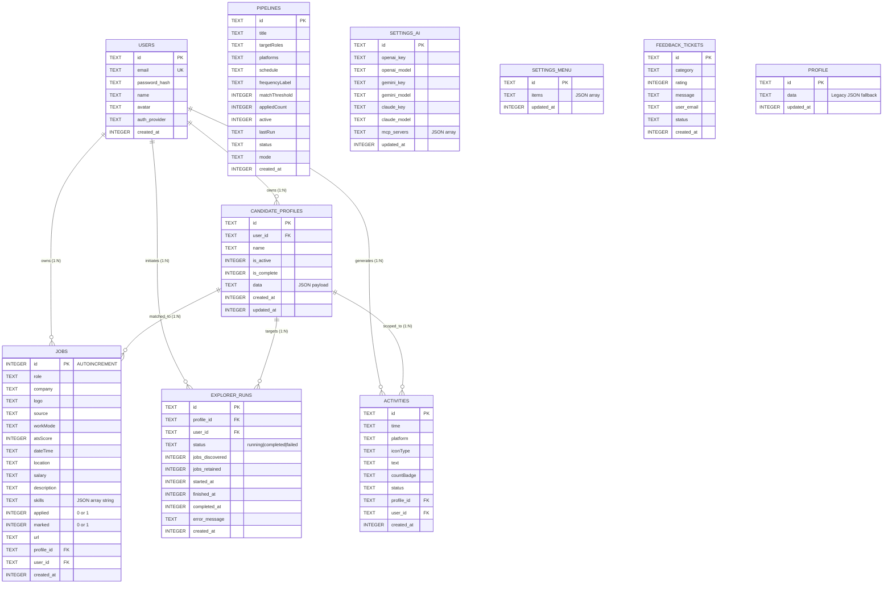

# Skill2Role: Database Architecture & Schema Specification

**System Version:** Skill2Role Engine 1.0.0 (Stage 1 Verified)  
**Database Engine:** SQLite 3.x (with Write-Ahead Logging `WAL` Mode & Busy Timeout)  
**File Location:** `backend/jobs.db`  
**Connection Handler:** `backend/database.py`  
**Last Verified:** October 2026  

---

## 1. Architectural Overview & Storage Engine

Skill2Role utilizes **SQLite 3** operating in **WAL (Write-Ahead Logging)** mode as its primary local persistence layer. This design eliminates heavy external database server prerequisites for local development, desktop agent execution, and edge runtime while providing high-performance concurrent reads and non-blocking background crawler writes.

### 1.1 Connection & Concurrency Primitives
Every connection created via `get_db_connection()` in [backend/database.py](file:///d:/JavaProjects/JobsOnly/backend/database.py) executes the following pragmas:

```sql
PRAGMA journal_mode = WAL;
PRAGMA synchronous = NORMAL;
PRAGMA busy_timeout = 5000;
```

- **`journal_mode = WAL`**: Readers do not block writers, and writers do not block readers. Reads access the `jobs.db-shm` (shared memory index) and `jobs.db-wal` (write log).
- **`synchronous = NORMAL`**: Critical transactions write to the WAL with periodic checkpoints, balancing data durability against disk I/O bottlenecks.
- **`busy_timeout = 5000`**: SQLite busy handler waits up to 5,000 milliseconds when acquiring exclusive table locks during bulk imports or crawling transactions before throwing `OperationalError: database is locked`.
- **`check_same_thread = False`**: Thread safety flag enabled to allow FastAPI thread pool workers and background crawling tasks to utilize managed connection pools.
- **`row_factory = sqlite3.Row`**: Enables dictionary-like attribute access on cursor results.

---

## 2. Entity-Relationship Model (ERD)

The following Mermaid diagram maps the database entities, primary keys, foreign references, and cardinality relationships across the Skill2Role system:



---

## 3. Comprehensive Table & Schema Dictionary

### 3.1 `candidate_profiles` (Multi-Persona Identity Store)
Stores isolated candidate profiles. Each persona holds tailored resume details, target roles, experience levels, and filtering exclusions.

| Column | Type | Nullable | Default | Description & Constraints |
| :--- | :--- | :---: | :---: | :--- |
| `id` | `TEXT` | **NO** | *None* | Primary Key (UUIDv4 or `'default'`). |
| `user_id` | `TEXT` | **NO** | `'default'` | Foreign Key referencing `users(id)`. |
| `name` | `TEXT` | **NO** | *None* | Human-readable persona label (e.g., "Senior Python Architect"). |
| `is_active` | `INTEGER` | **NO** | `0` | Boolean flag (1 = Active persona driving the Radar, 0 = Inactive). |
| `is_complete` | `INTEGER` | **NO** | `0` | Boolean flag evaluated against the 7 mandatory field validation rules. |
| `data` | `TEXT` | **NO** | *None* | Serialized JSON containing all 8 profile sections. |
| `created_at` | `INTEGER` | **NO** | *Epoch ms* | Millisecond Unix timestamp of profile creation. |
| `updated_at` | `INTEGER` | **NO** | *Epoch ms* | Millisecond Unix timestamp of last update. |

**Indexes:**
- `idx_candidate_profiles_user` on `(user_id)`
- `idx_candidate_profiles_active` on `(user_id, is_active)`

**JSON Schema Contract for `data`:**
```json
{
  "general": {
    "firstName": "string",
    "lastName": "string",
    "fullName": "string",
    "email": "string",
    "countryCode": "string",
    "phone": "string",
    "address1": "string",
    "address2": "string",
    "city": "string",
    "state": "string",
    "zipCode": "string",
    "country": "string",
    "bio": "string",
    "linkedinUrl": "string",
    "portfolioUrl": "string"
  },
  "contacts": { "fullName": "", "email": "", "phone": "", "location": "", "links": "" },
  "contactLinks": [{ "platform": "GitHub", "url": "https://..." }],
  "skillsList": ["Python", "FastAPI", "React", "Docker"],
  "primarySkill": "Python",
  "experiences": [
    {
      "company": "string",
      "position": "string",
      "startDate": "YYYY-MM",
      "endDate": "YYYY-MM",
      "current": true,
      "description": "string",
      "skills": ["string"]
    }
  ],
  "educationList": [
    {
      "school": "string",
      "degree": "string",
      "field": "string",
      "year": "YYYY"
    }
  ],
  "screeningAnswers": [{ "question": "string", "answer": "string" }],
  "languages": ["English"],
  "selectedRoles": ["Full Stack Engineer"],
  "selectedLevels": ["Senior", "Staff"],
  "userLocation": "Bengaluru, India",
  "desiredLocations": ["Remote", "Bengaluru"],
  "avoidCompanies": ["Meta", "Amazon"],
  "avoidSkills": ["PHP", "COBOL"],
  "avoidSources": ["Dice"],
  "summary": "Executive summary...",
  "resume": { "filename": "resume.pdf", "uploadedAt": 1718000000000 },
  "avatar": "avatar_1"
}
```

---

### 3.2 `jobs` (Discovered Opportunities & Radar Cache)
Stores all scraped, imported, and tracked job listings.

| Column | Type | Nullable | Default | Description & Constraints |
| :--- | :--- | :---: | :---: | :--- |
| `id` | `INTEGER` | **NO** | `AUTOINCREMENT` | Primary Key. |
| `role` | `TEXT` | **NO** | *None* | Job title or designation. |
| `company` | `TEXT` | **NO** | *None* | Employer organization name. |
| `logo` | `TEXT` | **NO** | *None* | SVG icon identifier or HTTP logo URL. |
| `source` | `TEXT` | **NO** | *None* | Ingestion source (e.g., `Greenhouse`, `Ashby`, `Lever`, `RemoteOK`, `Manual Import`). |
| `workMode` | `TEXT` | **NO** | `'Remote'` | Workplace arrangement: `'Remote'`, `'Hybrid'`, `'On-Site'`. |
| `atsScore` | `INTEGER` | **NO** | `0` | Calculated compatibility score (0 to 100). |
| `dateTime` | `TEXT` | **NO** | *None* | Human-formatted relative or ISO date (e.g., "2 hours ago", "2026-10-19"). |
| `location` | `TEXT` | **NO** | *None* | Geographical location or "Remote". |
| `salary` | `TEXT` | **NO** | *None* | Compensation string (e.g., "$140,000 - $180,000/yr"). |
| `description` | `TEXT` | **NO** | *None* | Full job posting description or summarized bullet points. |
| `skills` | `TEXT` | **NO** | `'[]'` | JSON array of required skill strings. |
| `applied` | `INTEGER` | **NO** | `0` | Boolean flag (1 = Applied, 0 = Unapplied). |
| `marked` | `INTEGER` | **NO** | `0` | Boolean flag (1 = Starred/Bookmarked, 0 = Default). |
| `url` | `TEXT` | **YES** | `''` | Direct URL to official ATS application portal. |
| `profile_id` | `TEXT` | **NO** | `'default'` | Persona ID for which this job was discovered. |
| `user_id` | `TEXT` | **NO** | `'default'` | User ID owner. |
| `created_at` | `INTEGER` | **NO** | *Epoch ms* | Millisecond timestamp of record insertion. |

**Indexes:**
- `idx_jobs_company` on `(company)`
- `idx_jobs_role` on `(role)`
- `idx_jobs_source` on `(source)`
- `idx_jobs_workMode` on `(workMode)`
- `idx_jobs_atsScore` on `(atsScore)`
- `idx_jobs_applied` on `(applied)`
- `idx_jobs_marked` on `(marked)`
- `idx_jobs_profile` on `(profile_id)`
- `idx_jobs_user` on `(user_id)`

---

### 3.3 `explorer_runs` (Crawler Execution & Run Auditing)
Tracks every automated radar sweep or manual discovery cycle.

| Column | Type | Nullable | Default | Description |
| :--- | :--- | :---: | :---: | :--- |
| `id` | `TEXT` | **NO** | *None* | Primary Key (e.g., `run_1718000000_abcd`). |
| `profile_id` | `TEXT` | **NO** | *None* | Foreign Key referencing `candidate_profiles(id)`. |
| `user_id` | `TEXT` | **NO** | `'default'` | Foreign Key referencing `users(id)`. |
| `status` | `TEXT` | **NO** | *None* | Execution state: `'running'`, `'completed'`, `'stopped'`, `'failed'`. |
| `jobs_discovered`| `INTEGER` | **NO** | `0` | Raw count of job postings scanned across sources. |
| `jobs_retained` | `INTEGER` | **NO** | `0` | Count of jobs matching profile criteria and saved to DB. |
| `started_at` | `INTEGER` | **NO** | *Epoch ms* | Run kickoff timestamp. |
| `finished_at` | `INTEGER` | **YES** | `NULL` | Run termination timestamp. |
| `completed_at` | `INTEGER` | **YES** | `NULL` | Alias timestamp for completion. |
| `error_message` | `TEXT` | **YES** | `NULL` | Failure traceback or error diagnostics. |
| `created_at` | `INTEGER` | **YES** | *Epoch ms* | Record timestamp. |

**Indexes:**
- `idx_explorer_runs_status` on `(status)`
- `idx_explorer_runs_profile` on `(profile_id)`

---

### 3.4 `users` (Authentication & Security Identities)
Stores local and OAuth-authenticated user credentials.

| Column | Type | Nullable | Default | Description |
| :--- | :--- | :---: | :---: | :--- |
| `id` | `TEXT` | **NO** | *None* | Primary Key (UUIDv4). |
| `email` | `TEXT` | **NO** | *None* | Unique email address (lowercased). |
| `password_hash` | `TEXT` | **NO** | *None* | PBKDF2-HMAC-SHA256 hashed password string. |
| `name` | `TEXT` | **NO** | *None* | User display name. |
| `avatar` | `TEXT` | **NO** | `'avatar_1'` | Avatar identifier or URI. |
| `auth_provider` | `TEXT` | **NO** | `'google'` | Authentication source (`'local'`, `'google'`). |
| `created_at` | `INTEGER` | **NO** | *Epoch ms* | Account creation timestamp. |

**Constraints:**
- `UNIQUE(email)`

---

### 3.5 `activities` (Event Audit Log)
Real-time activity audit log displayed on the dashboard feed.

| Column | Type | Nullable | Default | Description |
| :--- | :--- | :---: | :---: | :--- |
| `id` | `TEXT` | **NO** | *None* | Primary Key (UUIDv4). |
| `time` | `TEXT` | **NO** | *None* | Human formatted string (e.g. "Just now", "5m ago"). |
| `platform` | `TEXT` | **NO** | *None* | Associated ATS / platform (e.g., "Greenhouse", "System"). |
| `iconType` | `TEXT` | **NO** | *None* | Icon renderer key (`'radar'`, `'check'`, `'bot'`, `'file'`). |
| `text` | `TEXT` | **NO** | *None* | Log description narrative. |
| `countBadge` | `TEXT` | **YES** | `NULL` | Visual counter chip (e.g., `"+12"`). |
| `status` | `TEXT` | **NO** | *None* | Event badge severity (`'success'`, `'info'`, `'warning'`, `'pending'`). |
| `profile_id` | `TEXT` | **NO** | `'default'` | Persona filter scope. |
| `user_id` | `TEXT` | **NO** | `'default'` | User filter scope. |
| `created_at` | `INTEGER` | **NO** | *Epoch ms* | Millisecond ordering timestamp. |

**Indexes:**
- `idx_activities_profile` on `(profile_id)`
- `idx_activities_user` on `(user_id)`

---

### 3.6 `pipelines` (Automation Schedules - Stage 2 Precursor)
Configures autonomous job application runners.

| Column | Type | Nullable | Default | Description |
| :--- | :--- | :---: | :---: | :--- |
| `id` | `TEXT` | **NO** | *None* | Primary Key (e.g. `pipe_01`). |
| `title` | `TEXT` | **NO** | *None* | Pipeline title (e.g., "FastAPI / Python Roles"). |
| `targetRoles` | `TEXT` | **NO** | *None* | Roles targeted by this pipeline. |
| `platforms` | `TEXT` | **NO** | *None* | Target platforms (e.g., "Greenhouse, Ashby"). |
| `schedule` | `TEXT` | **NO** | *None* | Cron or human schedule string (e.g., "Daily at 09:00 AM"). |
| `frequencyLabel`| `TEXT` | **NO** | *None* | Short label (e.g., "Daily"). |
| `matchThreshold`| `INTEGER` | **NO** | `85` | Minimum ATS score required to trigger auto-apply. |
| `appliedCount` | `INTEGER` | **NO** | `0` | Number of applications dispatched through this pipeline. |
| `active` | `INTEGER` | **NO** | `1` | Toggle switch (1 = Active, 0 = Paused). |
| `lastRun` | `TEXT` | **NO** | *None* | Last execution time or "Never". |
| `status` | `TEXT` | **NO** | `'ACTIVE'` | Running status (`'ACTIVE'`, `'PAUSED'`, `'ERROR'`). |
| `mode` | `TEXT` | **NO** | `'Auto-Apply'` | Pipeline mode (`'Auto-Apply'`, `'Supervised'`). |
| `created_at` | `INTEGER` | **NO** | *Epoch ms* | Creation timestamp. |

---

### 3.7 `settings_ai` (LLM Engine & MCP Configuration)
Stores user-configured LLM API keys, model selections, and registered MCP server endpoints.

| Column | Type | Nullable | Default | Description |
| :--- | :--- | :---: | :---: | :--- |
| `id` | `TEXT` | **NO** | *None* | Primary Key (`'default'`). |
| `openai_key` | `TEXT` | **YES** | `''` | User OpenAI API secret key. |
| `openai_model` | `TEXT` | **NO** | `'gpt-4o'` | Active OpenAI model string. |
| `gemini_key` | `TEXT` | **YES** | `''` | Google Gemini API secret key. |
| `gemini_model` | `TEXT` | **NO** | `'gemini-1.5-pro'` | Active Gemini model string. |
| `claude_key` | `TEXT` | **YES** | `''` | Anthropic Claude API secret key. |
| `claude_model` | `TEXT` | **NO** | `'claude-3-5-sonnet'` | Active Claude model string. |
| `mcp_servers` | `TEXT` | **NO** | `'[]'` | Serialized JSON array of registered MCP servers. |
| `updated_at` | `INTEGER` | **NO** | *Epoch ms* | Timestamp of last modification. |

---

### 3.8 `settings_menu` (Dynamic Navigation Layout)
Stores user-defined navigation item ordering and visibility toggles.

| Column | Type | Nullable | Default | Description |
| :--- | :--- | :---: | :---: | :--- |
| `id` | `TEXT` | **NO** | *None* | Primary Key (`'default'`). |
| `items` | `TEXT` | **NO** | *None* | Serialized JSON array of navigation items. |
| `updated_at` | `INTEGER` | **NO** | *Epoch ms* | Timestamp of last modification. |

---

### 3.9 `feedback_tickets` (User Issue Reporting)
Stores in-app feedback submissions and bug reports.

| Column | Type | Nullable | Default | Description |
| :--- | :--- | :---: | :---: | :--- |
| `id` | `TEXT` | **NO** | *None* | Primary Key (UUIDv4). |
| `category` | `TEXT` | **NO** | *None* | Category (`'bug'`, `'feature'`, `'general'`). |
| `rating` | `INTEGER` | **NO** | `5` | User star rating (1–5). |
| `message` | `TEXT` | **NO** | *None* | User feedback narrative. |
| `user_email` | `TEXT` | **NO** | *None* | Submitting user email. |
| `status` | `TEXT` | **NO** | `'open'` | Ticket lifecycle status (`'open'`, `'resolved'`). |
| `created_at` | `INTEGER` | **NO** | *Epoch ms* | Creation timestamp. |

---

### 3.10 `profile` (Legacy Single-Profile Store)
Maintained for backwards-compatibility with early versions of the front-end before multi-persona architecture was introduced.

| Column | Type | Nullable | Default | Description |
| :--- | :--- | :---: | :---: | :--- |
| `id` | `TEXT` | **NO** | `'default'` | Primary Key. |
| `data` | `TEXT` | **NO** | *None* | Serialized candidate JSON profile. |
| `updated_at` | `INTEGER` | **NO** | *Epoch ms* | Timestamp of last save. |

---

## 4. Schema Migration & Evolution Strategy

In [backend/database.py](file:///d:/JavaProjects/JobsOnly/backend/database.py), the `init_db()` function handles non-destructive idempotent schema evolution during backend startup:

1. **Table Creation**: `CREATE TABLE IF NOT EXISTS` generates base tables if `jobs.db` is missing.
2. **Column Augmentation**: Safe column migration patterns use wrapped `ALTER TABLE {table} ADD COLUMN {col_def}` try/except blocks to ensure zero data loss when deploying updates over existing databases:
   ```python
   for col_def in [
       "url TEXT DEFAULT ''",
       "marked INTEGER DEFAULT 0",
       "profile_id TEXT DEFAULT 'default'",
       "user_id TEXT DEFAULT 'default'"
   ]:
       try:
           conn.execute(f"ALTER TABLE jobs ADD COLUMN {col_def}")
       except Exception:
           pass  # Column already exists
   ```
3. **Index Creation**: Safe `CREATE INDEX IF NOT EXISTS` guarantees optimal query plans without causing duplicate index creation errors.
4. **Seed Provisioning**: Checks if singleton records (`settings_ai:default`, `settings_menu:default`, `candidate_profiles:default`) exist. If absent, it inserts pristine blank structures.

---

## 5. Maintenance, Backup, and Factory Reset

### 5.1 Factory Reset & Clear Clean Slate
When a user requests a clean slate (via UI settings or backend admin), the database calls `clear_dummy_data()`:
```sql
DELETE FROM jobs;
DELETE FROM activities;
DELETE FROM pipelines;
DELETE FROM feedback_tickets;
DELETE FROM explorer_runs;
DELETE FROM users;
VACUUM;
```
`VACUUM` defragments the SQLite storage file, reclaims unused pages, and resets file size back to initial state (~60 KB).

### 5.2 Hot Backup Procedure
Because WAL mode separates active writes into `jobs.db-wal`, a standard file copy of `jobs.db` while the server is running may capture a partially committed state. Use the SQLite Backup API:
```bash
sqlite3 jobs.db ".backup 'backups/jobs_backup_$(date +%Y%m%d_%H%M%S).db'"
```
Or execute through Python:
```python
import sqlite3
def backup_database(destination_path):
    with sqlite3.connect("jobs.db") as src:
        with sqlite3.connect(destination_path) as dst:
            src.backup(dst)
```

### 5.3 Data Retention & Purge Rules
- **Jobs Table**: Historical jobs older than 90 days with `applied = 0` and `marked = 0` can be pruned without affecting analytics or saved bookmarks.
- **Explorer Runs**: Runs are retained for 30 days to power the 5-day history analytics bar chart on the Explorer tab.
- **Activities**: Dashboard activities are capped at 1,000 entries; older events are automatically truncated during background sync.
