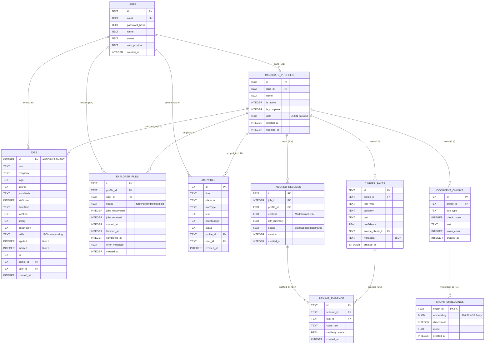

# Skill2Role: Database Architecture & Schema Specification

**System Version:** Skill2Role Engine 2.0.0 (Stage 1 & Stage 2 Verified)  
**Database Engine:** SQLite 3.x (with Write-Ahead Logging `WAL` Mode & Busy Timeout)  
**File Location:** `backend/jobs.db`  
**Connection Handler:** `backend/database.py`  
**Audit & Review Date:** October 21, 2026  
**Audited Repository State:** Commit working tree (`backend/jobs.db`, `backend/database.py`)  

---

> [!NOTE]
> **Audited Data State:**  
> Previous documentation asserted that the database held 15,500 simulated jobs. Physical inspection of `backend/jobs.db` and `backend/seed_india_jobs.py` confirms that the database contains **25 realistic seeded Indian tech jobs** across Bangalore, Pune, Hyderabad, and Remote. The local RAG pipeline schemas (`career_facts`, `document_chunks`, `chunk_embeddings`, `tailored_resumes`, `resume_evidence`) have been successfully integrated and verified.

---

## 1. Architectural Overview & Storage Engine

Skill2Role utilizes **SQLite 3** operating in **WAL (Write-Ahead Logging)** mode as its primary local persistence layer. This design eliminates heavy external database server prerequisites for local development and edge desktop execution while providing high-performance concurrent reads and non-blocking background crawler writes.

### 1.1 Connection & Concurrency Primitives
Every connection created via `get_db_connection()` in [backend/database.py](file:///d:/JavaProjects/JobsOnly/backend/database.py) executes the following pragmas:

```sql
PRAGMA journal_mode = WAL;
PRAGMA synchronous = NORMAL;
PRAGMA busy_timeout = 5000;
```

- **`journal_mode = WAL`**: Readers do not block writers, and writers do not block readers. Reads access the `jobs.db-shm` (shared memory index) and `jobs.db-wal` (write log).
- **`synchronous = NORMAL`**: Critical transactions write to the WAL with periodic checkpoints, balancing data durability against disk I/O bottlenecks.
- **`busy_timeout = 5000`**: SQLite busy handler waits up to 5,000 milliseconds when acquiring exclusive table locks during bulk imports or crawling transactions before throwing `OperationalError: database is locked`.
- **`check_same_thread = False`**: Thread safety flag enabled to allow FastAPI thread pool workers and background crawling tasks to utilize managed connection pools.
- **`row_factory = sqlite3.Row`**: Enables dictionary-like attribute access on cursor results.

---

## 2. Complete Entity-Relationship Model (ERD)

The following diagram maps the database entities, primary keys, foreign references, and cardinality relationships across the Stage 1 core and Stage 2 RAG pipeline:



---

## 3. Core Table Schema Specifications

### 3.1 `users` (Account Credentials)
Stores account login identities, hashed credentials, and authentication providers.

| Column | Type | Nullable | Default | Description |
| :--- | :--- | :---: | :---: | :--- |
| `id` | `TEXT` | **NO** | *None* | Primary Key (UUIDv4). |
| `email` | `TEXT` | **NO** | *None* | Unique candidate email address. |
| `password_hash` | `TEXT` | **NO** | *None* | Static-salted SHA-256 hash *(flagged for PBKDF2 upgrade)*. |
| `name` | `TEXT` | **NO** | *None* | User display name. |
| `avatar` | `TEXT` | YES | `''` | Avatar URL or data URI. |
| `auth_provider` | `TEXT` | **NO** | `'local'` | Authentication source (`'local'`, `'google'`). |
| `created_at` | `INTEGER` | **NO** | *Epoch ms* | Unix timestamp of creation. |

### 3.2 `candidate_profiles` (Professional Personas)
Stores candidate career personas, skills, bios, and configuration metadata.

| Column | Type | Nullable | Default | Description |
| :--- | :--- | :---: | :---: | :--- |
| `id` | `TEXT` | **NO** | *None* | Primary Key (UUIDv4). |
| `user_id` | `TEXT` | **NO** | `'default'` | Owning user account reference. |
| `name` | `TEXT` | **NO** | *None* | Persona title (e.g., "Senior Backend Engineer"). |
| `is_active` | `INTEGER` | **NO** | `0` | Flag: `1` if currently active; `0` otherwise. |
| `is_complete`| `INTEGER` | **NO** | `0` | Flag: `1` if all 7 mandatory gate fields are populated. |
| `data` | `TEXT` | **NO** | `'{}'` | JSON document containing full structured resume fields. |
| `created_at` | `INTEGER` | **NO** | *Epoch ms* | Timestamp of creation. |
| `updated_at` | `INTEGER` | **NO** | *Epoch ms* | Timestamp of last modification. |

### 3.3 `jobs` (Opportunities & Indian Tech Seed)
Stores discovered, imported, and seeded job listings. Currently populated with 25 realistic Indian tech postings from `seed_india_jobs.py`.

| Column | Type | Nullable | Default | Description |
| :--- | :--- | :---: | :---: | :--- |
| `id` | `INTEGER` | **NO** | *Autoincrement* | Primary Key. |
| `role` | `TEXT` | **NO** | *None* | Job title (e.g., "Lead Python Architect"). |
| `company` | `TEXT` | **NO** | *None* | Hiring organization (e.g., "Swiggy", "CRED", "Razorpay"). |
| `logo` | `TEXT` | YES | `''` | Company logo URL or inline SVG placeholder. |
| `source` | `TEXT` | **NO** | `'Direct ATS'` | Origin platform (`'Greenhouse'`, `'Ashby'`, `'Lever'`, `'RemoteOK'`). |
| `workMode` | `TEXT` | **NO** | `'Remote'` | Work model (`'Remote'`, `'Hybrid'`, `'On-site'`). |
| `atsScore` | `INTEGER` | **NO** | `75` | Calculated compatibility score (0–100). |
| `dateTime` | `TEXT` | **NO** | *ISO String* | Discovery or posting date. |
| `location` | `TEXT` | **NO** | `'Bengaluru'` | Geographic location. |
| `salary` | `TEXT` | YES | `''` | Compensation bracket (e.g., "₹35L - ₹50L PA"). |
| `description`| `TEXT` | **NO** | *None* | Full job description text. |
| `skills` | `TEXT` | **NO** | `'[]'` | JSON array string of required skills. |
| `applied` | `INTEGER` | **NO** | `0` | Flag: `1` if applied; `0` otherwise. |
| `marked` | `INTEGER` | **NO** | `0` | Flag: `1` if bookmarked; `0` otherwise. |
| `url` | `TEXT` | YES | `''` | External application URL. |
| `profile_id` | `TEXT` | **NO** | `'default'` | Persona scope reference. |
| `user_id` | `TEXT` | **NO** | `'default'` | User scope reference. |
| `created_at` | `INTEGER` | **NO** | *Epoch ms* | Ingestion timestamp. |

---

## 4. Stage 2 Local RAG Pipeline Schemas

### 4.1 `career_facts` (Extracted Resume Truths)
Stores atomic, verified career facts extracted from candidate resumes to serve as the ground truth during LLM generation.

| Column | Type | Nullable | Default | Description |
| :--- | :--- | :---: | :---: | :--- |
| `id` | `TEXT` | **NO** | *None* | Primary Key (UUIDv4). |
| `profile_id` | `TEXT` | **NO** | *None* | Reference to `candidate_profiles.id`. |
| `fact_type` | `TEXT` | **NO** | *None* | Category: `'skill'`, `'metric'`, `'title'`, `'company'`, `'education'`, `'certification'`. |
| `category` | `TEXT` | YES | `''` | Sub-category (e.g., `'backend'`, `'cloud'`). |
| `text` | `TEXT` | **NO** | *None* | Normalized fact statement (e.g., "Built streaming pipeline processing 10k req/sec"). |
| `confidence` | `REAL` | **NO** | `1.0` | Extraction confidence score (0.0–1.0). |
| `source_chunk_id` | `TEXT` | YES | *None* | Foreign key to `document_chunks.id`. |
| `metadata` | `TEXT` | YES | `'{}'` | JSON metadata dictionary. |
| `created_at` | `INTEGER` | **NO** | *Epoch ms* | Ingestion timestamp. |

### 4.2 `document_chunks` & `document_chunks_fts` (Chunk Text & Lexical Index)
Stores segmented paragraphs from uploaded resumes and provides an SQLite FTS5 virtual table for BM25 text search.

```sql
-- Underlying table
CREATE TABLE IF NOT EXISTS document_chunks (
    id TEXT PRIMARY KEY,
    profile_id TEXT NOT NULL,
    doc_type TEXT NOT NULL,
    chunk_index INTEGER NOT NULL,
    text TEXT NOT NULL,
    token_count INTEGER NOT NULL,
    created_at INTEGER NOT NULL
);

-- FTS5 Full-Text Search Virtual Table
CREATE VIRTUAL TABLE IF NOT EXISTS document_chunks_fts USING fts5(
    chunk_id UNINDEXED,
    profile_id,
    text,
    tokenize='porter unicode61'
);
```

### 4.3 `chunk_embeddings` (Local 384-Dim Vector Storage)
Stores deterministic hash-based TF-IDF token vector projections as raw binary BLOBs (`FLOAT32` arrays) to enable local cosine similarity retrieval without external vector databases.

| Column | Type | Nullable | Default | Description |
| :--- | :--- | :---: | :---: | :--- |
| `chunk_id` | `TEXT` | **NO** | *None* | Primary Key, references `document_chunks.id`. |
| `embedding` | `BLOB` | **NO** | *None* | Binary serialized IEEE 754 float32 array (384 dimensions, 1536 bytes). |
| `dimensions` | `INTEGER` | **NO** | `384` | Embedding dimensionality. |
| `model` | `TEXT` | **NO** | `'local-hash-tfidf-384'` | Identifier of embedding projection engine. |
| `created_at` | `INTEGER` | **NO** | *Epoch ms* | Vectorization timestamp. |

### 4.4 `tailored_resumes` & `resume_evidence` (Tailoring & Verification Tracking)
Tracks generated resume drafts, bullet-point diffs, factual validation results, and submission gate compliance.

| Column | Type | Nullable | Default | Description |
| :--- | :--- | :---: | :---: | :--- |
| `id` | `TEXT` | **NO** | *None* | Primary Key (UUIDv4). |
| `job_id` | `INTEGER` | **NO** | *None* | Target job reference (`jobs.id`). |
| `profile_id` | `TEXT` | **NO** | *None* | Candidate persona reference (`candidate_profiles.id`). |
| `content` | `TEXT` | **NO** | *None* | Serialized tailored resume (Markdown/JSON). |
| `diff_summary` | `TEXT` | YES | `''` | Summary of bullet modifications. |
| `status` | `TEXT` | **NO** | `'draft'` | Lifecycle: `'draft'`, `'validated'`, `'approved'`, `'rejected'`. |
| `version` | `INTEGER` | **NO** | `1` | Revision number. |
| `created_at` | `INTEGER` | **NO** | *Epoch ms* | Generation timestamp. |

---

## 5. Schema Migration & Idempotent Initialization

In `backend/database.py`, `init_db()` executes idempotent initialization steps during backend startup:
1. **Base Tables:** `CREATE TABLE IF NOT EXISTS` generates base entity tables.
2. **Column Migrations:** Safe `ALTER TABLE {table} ADD COLUMN {col_def}` try/except blocks add new columns to older databases without data loss.
3. **FTS5 Virtual Tables:** Creates `document_chunks_fts` virtual table if absent.
4. **Seed Checking:** Inspects `jobs` table count. If 0, executes `seed_india_jobs.py` to populate 25 initial realistic Indian tech opportunities.

---

## 6. Maintenance & Backup Protocols

### 6.1 Database Backups (WAL-Safe)
Because WAL mode separates active writes into `jobs.db-wal`, a plain filesystem copy while the server is active risks partial transactions. Use Python's SQLite backup API:
```python
import sqlite3

def backup_database(destination_path: str):
    with sqlite3.connect("backend/jobs.db") as src:
        with sqlite3.connect(destination_path) as dst:
            src.backup(dst)
```

### 6.2 Factory Reset Procedure
Invoking `POST /api/settings/factory-reset` triggers `clear_dummy_data()`, which wipes non-seed records, resets explorer runs, and executes `VACUUM` to reclaim disk space.
