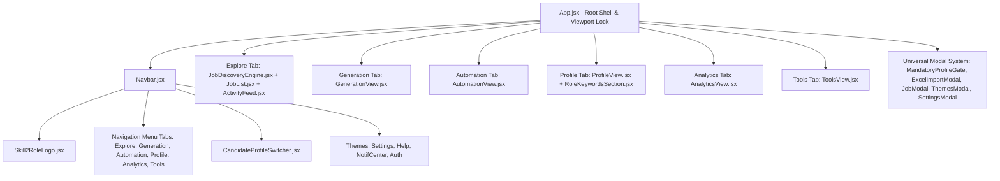

# UI/UX & Design System Specification

**Product:** Skill2Role  
**Document Version:** 1.0.0  
**Status:** Canonical Design System Reference  
**Design Standard:** Senior UI/UX Designer, Senior Frontend Architect  

---

## 1. Design Philosophy & Visual Principles

Skill2Role implements a high-density, low-friction professional design system built on the **60–30–10–5 Color Harmony Rule**:
- **60% Dominant Canvas:** Neutral background canvas establishing baseline reading contrast (`--rp-dominant-bg`).
- **30% Secondary Surfaces:** Cards, sidebar panels, modals, and container surfaces (`--rp-secondary-surface`, `--rp-secondary-border`).
- **10% Intentional Accents:** Brand anchors, active navigation states, primary buttons, and live radar signals (`--rp-accent-primary`, `--rp-accent-secondary`).
- **5% Semantic Micro-Tier:** Feedback indicators for success, warning, destructive actions, and informational toasts (`--rp-semantic-*`).

### Core Aesthetic Pillars
1. **Zero Artificial Flares:** Animations only occur in response to real data events (e.g. verified SSE job discoveries). No decorative particle loops simulating fake activity.
2. **Deterministic Theme Adaptability:** Every component uses CSS custom properties (`var(--rp-*)`). Hardcoded hex colors and utility frameworks (TailwindCSS) are strictly banned.
3. **Viewport-Locked Ergonomics:** All primary views (`#explore`, `#generation`, `#automation`, `#profile`, `#analytics`, `#tools`) lock the browser viewport (`overflow: hidden`), utilizing internal localized scrollbars to eliminate double window scrollbars.

---

## 2. Supported Themes & Color Modes

The system supports **2 Curated Themes** across **2 Color Modes** ($2 \times 2 = 4$ distinct visual presentations). Note: *Glass* and *Difference* themes were decommissioned to guarantee strict UI/UX contrast, eliminate cross-browser blur degradation, and minimize maintenance complexity.

### 2.1 Supported Themes
| Theme ID | Design Aesthetic | Key Visual Signature |
| :--- | :--- | :--- |
| `default` | Clean Modern Enterprise | Slate/emerald borders, crisp typography, subtle shadows, balanced 60–30–10 hierarchy. |
| `minimal` | Stark Monospace & High-Contrast | 1px clean hairline borders, zero box-shadows, geometric precision, monochrome high-contrast. |

### 2.2 Color Modes
- **Light Mode (`data-mode="light"`):** Bright, high-clarity canvas designed for daytime readability.
- **Dark Mode (`data-mode="dark"`):** Deep charcoal/zinc canvas designed for extended developer sessions.

### 2.3 Theme Initialization & Persistence
- The active theme is stored in `localStorage` keys:
  - `rp_theme`: `'default' | 'minimal'` (legacy `'glass'` or `'difference'` are automatically migrated to `'default'`)
  - `rp_color_mode`: `'light' | 'dark' | 'default'`
- Synchronized to the root DOM node:
  ```html
  <html data-theme="default" data-mode="dark" data-page="explore">
  ```

---

## 3. Design Tokens Architecture (`colors.css`)

Located at: [frontend/src/styles/tokens/colors.css](file:///d:/JavaProjects/JobsOnly/frontend/src/styles/tokens/colors.css)

### 3.1 Color Token Mapping

```css
/* Light Mode Tokens */
:root {
  --rp-dominant-bg: #F7F9F8;
  --rp-dominant-canvas: #F0F2F0;
  --rp-secondary-surface: #FFFFFF;
  --rp-secondary-border: #DDE2DE;
  --rp-secondary-border-hover: #B0B8B2;
  
  --rp-text-dominant: #171A18;
  --rp-text-secondary: #5A615C;
  --rp-text-muted: #6B7570;
  
  --rp-accent-primary: #2563EB;
  --rp-accent-primary-hover: #1D4ED8;
  --rp-accent-secondary: #0D9488;
  
  --rp-semantic-success: #059669;
  --rp-semantic-warning: #D97706;
  --rp-semantic-danger: #DC2626;
  --rp-semantic-info: #0284C7;
}

/* Dark Mode Overrides */
[data-mode="dark"] {
  --rp-dominant-bg: #0E110F;
  --rp-dominant-canvas: #090B0A;
  --rp-secondary-surface: #161A17;
  --rp-secondary-border: #262C27;
  --rp-secondary-border-hover: #3E4740;
  
  --rp-text-dominant: #ECF0ED;
  --rp-text-secondary: #A6AFA8;
  --rp-text-muted: #7E8780;
  
  --rp-accent-primary: #3B82F6;
  --rp-accent-secondary: #14B8A6;
  
  --rp-semantic-success: #10B981;
  --rp-semantic-warning: #F59E0B;
  --rp-semantic-danger: #EF4444;
  --rp-semantic-info: #38BDF8;
}
```

---

## 4. Typography & Spatial Tokens

### 4.1 Typography
- **Primary Font Family:** System font stack (`-apple-system, BlinkMacSystemFont, "Segoe UI", Roboto, "Inter", sans-serif`).
- **Monospace Family (Code / ATS Tokens):** `ui-monospace, "SF Mono", Menlo, Consolas, monospace`.
- **Type Scale:**
  - `Header H1`: 24px / 1.2 line-height / Semi-Bold (700)
  - `Header H2`: 18px / 1.3 line-height / Semi-Bold (600)
  - `Header H3`: 15px / 1.4 line-height / Medium (600)
  - `Body Regular`: 13px / 1.5 line-height / Regular (400)
  - `Caption / Badge`: 11px / 1.4 line-height / Medium (500)
  - `Micro / Code`: 10px / 1.3 line-height / Semi-Bold (600)

### 4.2 Spacing & Radii
- **Spacing Grid:** 4px base (`4px`, `8px`, `12px`, `16px`, `20px`, `24px`, `32px`).
- **Border Radii:**
  - Pavements & Outer Cards: `12px`
  - Inner Containers & Tables: `8px`
  - Badges, Buttons & Filters: `6px`
  - Pill Selectors & Avatars: `9999px` (Full circle)

---

## 5. Component Hierarchy & UX Patterns



---

## 6. Universal Modal & Dialog System (`UniversalModal.css`)

All modals adhere to the universal modal styling:
1. **Backdrop:** `background: rgba(0, 0, 0, 0.65)`, `backdrop-filter: blur(8px)`.
2. **Container:** `max-width: 620px`, centered flexbox alignment, smooth `translateY(0)` entrance animation.
3. **Header:** Title with descriptive caption and explicit accessible close button (`aria-label="Close modal"`).
4. **Body:** Scrollable container with non-intrusive slim scrollbars.
5. **Footer:** Primary CTA aligned to the right, secondary/cancel action on the left.

### Key Modals in System
- **`MandatoryProfileGate.jsx`:** Shows 7 mandatory fields with check/cross indicators and "Complete Profile" action.
- **`ExcelImportModal.jsx`:** Drag-and-drop file upload zone with sample column specifications and import progress bar.
- **`JobModal.jsx`:** Full job detail overlay with apply trigger, bookmarking, and parsed keyword tags.
- **`ThemesModal.jsx`:** Interactive cards for 4 themes and 2 modes with live instant preview.

---

## 7. Accessibility & Motion Guidelines

1. **Reduced Motion Support:** All CSS transitions and Canvas particle rendering respect the system preference:
   ```css
   @media (prefers-reduced-motion: reduce) {
     *, ::before, ::after {
       animation-duration: 0.01ms !important;
       transition-duration: 0.01ms !important;
     }
   }
   ```
2. **Focus Visibility:** Interactive elements display an intentional 2px focus ring:
   ```css
   :focus-visible {
     outline: 2px solid var(--rp-accent-primary);
     outline-offset: 2px;
   }
   ```
3. **Contrast Compliance:** All text tiers pass WCAG 2.1 AA ($4.5:1$ for normal body text, $3.0:1$ for large text).
