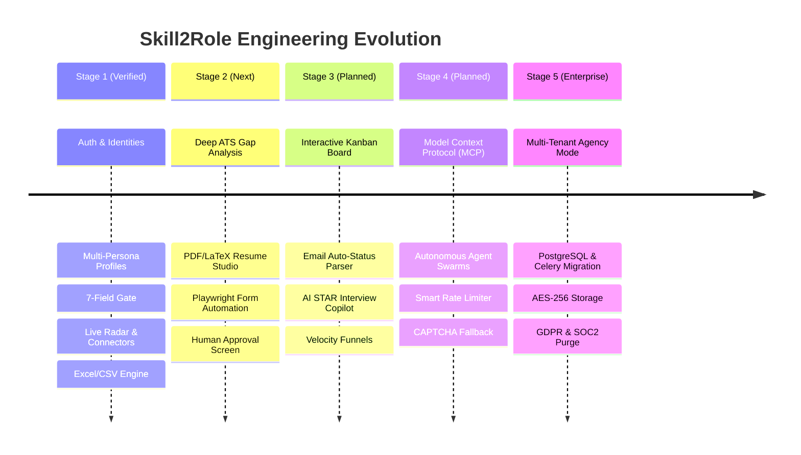

# Skill2Role: Future Development & Engineering Roadmap

**Document Purpose:** Forward-looking architectural roadmap, feature evolution, scalability initiatives, and risk management plan across Stages 2 through 5.  
**Current Baseline:** Stage 1 Foundation & Explorer 100% Implemented & Verified.  
**Classification:** Planned & Proposed (Non-Committed until authorized).  
**Last Updated:** October 2026  

---

## 1. Executive Summary & Strategic Evolution

Skill2Role transforms from a high-speed job discovery radar (Stage 1) into a fully autonomous, intelligent career copilot and application agent swarm.

---

## 2. Stage 2: Target Role Matching, ATS Optimization & Automation

*Status: Fully specified in [stage-2-ai-tailoring-autoapply.md](file:///d:/JavaProjects/JobsOnly/docs/stages/stage-2-ai-tailoring-autoapply.md). Awaiting explicit user authorization.*

### 2.1 Deep ATS Match & Keyword Gap Engine
- **Objective:** Move beyond generic keyword matching to semantic, syntax-tree comparison between candidate profiles and job requirements.
- **Capabilities:**
  - Token-level classification: Missing hard skills, missing soft skills, required certifications, and experience level mismatches.
  - Interactive keyword gap visualizer displaying weighted importance per skill.
- **Complexity:** Medium (3 sprints)
- **Measurable Criteria:** Generates sub-second breakdown with $\ge 90\%$ correlation to real Greenhouse/Ashby candidate scoring.

### 2.2 Resume & Cover Letter Generation Studio
- **Objective:** Contextually tailor resumes and cover letters for specific job postings.
- **Capabilities:**
  - Multi-template rendering engine supporting clean ATS-friendly LaTeX, HTML/CSS, and PDF output via WeasyPrint.
  - Diff visualizer highlighting specific bullet points altered to match the target job description.
- **Complexity:** High (4 sprints)

### 2.3 Headless Application Submission Automation
- **Objective:** Automate form entry on Greenhouse, Lever, and Ashby job boards.
- **Capabilities:**
  - Playwright browser worker with encrypted session cookie management.
  - Human-in-the-Loop (HITL) approval screen: Agent fills 100% of fields, snapshots the page, and prompts candidate for 1-click confirmation before submission.
- **Risk & Mitigation:** Platform anti-bot detection; mitigated by human approval gates and randomized interaction intervals.

---

## 3. Stage 3: Application Lifecycle Tracking, Analytics Funnel & Interview Prep

*Status: Fully specified in [stage-3-tracking-analytics-interview.md](file:///d:/JavaProjects/JobsOnly/docs/stages/stage-3-tracking-analytics-interview.md).*

### 3.1 5-Stage Drag-and-Drop Kanban Board
- **Columns:** `Saved` $\to$ `Tailored` $\to$ `Applied` $\to$ `Interviewing` $\to$ `Offer / Archived`.
- **Automated State Transitions:** Submitting an application automatically moves the job card from `Saved` to `Applied`.

### 3.2 Automated Email Parser & Status Sync
- **Capabilities:** IMAP / Gmail OAuth integration scanning candidate inboxes for interview invites, screening requests, and rejection notices, updating Kanban cards in real time.

### 3.3 AI STAR Interview Simulator
- **Capabilities:**
  - Simulates technical phone screens, behavioral interviews (Situation, Task, Action, Result), and system design challenges based on the specific job description.
  - Voice-driven mock interview mode with real-time speech-to-text and AI critique.

---

## 4. Stage 4: Autonomous Agent Swarms & MCP Ecosystem

*Status: Fully specified in [stage-4-autonomous-agents-mcp.md](file:///d:/JavaProjects/JobsOnly/docs/stages/stage-4-autonomous-agents-mcp.md).*

### 4.1 Model Context Protocol (MCP) Tool Servers
- Implement native MCP client and server connectors.
- Expose candidate profile data, resume repositories, and job feeds as standard MCP resources and tools.
- Enable external AI agents (Cursor, Claude Desktop, Antigravity IDE) to seamlessly invoke Skill2Role tools.

### 4.2 Multi-Agent Swarm Orchestration
- **Agent Roles:**
  - **Scout Agent:** Continuously crawls target company career portals.
  - **Evaluator Agent:** Calculates ATS match and filters against user avoid lists.
  - **Tailor Agent:** Generates custom resume and cover letter variants.
  - **Submission Agent:** Fills out job board forms and notifies user for confirmation.

---

## 5. Stage 5: Multi-Tenant Recruiter Mode, Cloud Scale & Security

*Status: Fully specified in [stage-5-enterprise-recruiter-scale.md](file:///d:/JavaProjects/JobsOnly/docs/stages/stage-5-enterprise-recruiter-scale.md).*

### 5.1 Architecture & Infrastructure Scaling
- **Database Migration:** Provide a zero-downtime migration path from SQLite WAL to managed PostgreSQL (Amazon RDS / Supabase).
- **Distributed Task Queues:** Decouple crawler jobs and Playwright workers using Celery / Redis or Temporal workflows.
- **Horizontal Scaling:** Containerize backend and worker instances with Docker and Kubernetes manifests.

### 5.2 Enterprise Recruiter Mode & Agency Pool
- Candidate roster management: Recruiters manage hundreds of candidate profiles simultaneously.
- Batch matching: Match a single job description against an entire candidate roster.
- Granular Role-Based Access Control (RBAC): `Owner`, `Agency Admin`, `Recruiter`, `Candidate`.

### 5.3 Enterprise Compliance & Data Privacy
- AES-256 field-level encryption for sensitive profile documents and passwords.
- Automated GDPR / CCPA right-to-be-forgotten cryptographic purge endpoints.

---

## 6. Technical Debt & Refactoring Priorities

1. **Move from Mixed Synchronous/Asynchronous Handlers:**
   - *Current:* Certain crawler operations run synchronous requests inside FastAPI async handlers.
   - *Plan:* Standardize all network I/O on `httpx.AsyncClient` with connection pooling.
2. **Frontend State Refactoring:**
   - *Current:* `App.jsx` coordinates multiple view states directly.
   - *Plan:* Introduce dedicated Zustand or React Context stores for `JobsStore`, `RadarStore`, and `PersonasStore`.
3. **Database Migration Tooling:**
   - *Current:* Custom `ALTER TABLE` try/catch logic in `init_db()`.
   - *Plan:* Integrate Alembic for declarative schema versioning when transitioning to PostgreSQL in Stage 5.
