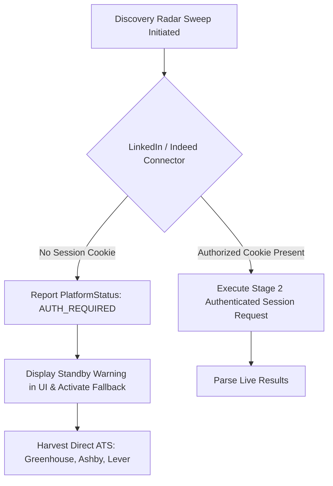

# Skill2Role: System Integrations Inventory & Technical Specifications

**Document Purpose:** Comprehensive catalog of external and internal platform integrations, ingestion scrapers, AI LLM connectors, authentication requirements, rate-limiting constraints, and failure-handling procedures.  
**System Version:** 2.0.0 (Stage 1 Implemented & Verified)  
**Last Updated:** October 2026  

---

## 1. Integrations Status Matrix

| Integration Name | Integration Type | Provider / Authority | Current Status | Authentication Required | Primary Location in Codebase |
| :--- | :--- | :--- | :---: | :---: | :--- |
| **Greenhouse API** | Enterprise ATS Ingestion | Greenhouse Software Inc. | **ACTIVE** | Public Endpoint | `backend/harvest/greenhouse.py` |
| **Ashby API** | Enterprise ATS Ingestion | Ashby, Inc. | **ACTIVE** | Public Endpoint | `backend/harvest/ashby.py` |
| **Lever Postings API** | Enterprise ATS Ingestion | Lever / Employ Inc. | **ACTIVE** | Public Endpoint | `backend/harvest/lever.py` |
| **RemoteOK API** | Remote Job Board Ingestion | Remote OK | **ACTIVE** | Public Endpoint | `backend/harvest/remote_boards.py` |
| **Remotive API** | Remote Job Board Ingestion | Remotive SAS | **ACTIVE** | Public Endpoint | `backend/harvest/remote_boards.py` |
| **LinkedIn Jobs** | Professional Network Ingestion | LinkedIn Corporation | **STANDBY (Stage 2)** | Session Cookie (`li_at`) | `backend/services/platform_searcher.py` |
| **Indeed Jobs** | Aggregator Ingestion | Indeed, Inc. | **STANDBY (Stage 2)** | Session / Cloudflare Pass | `backend/services/platform_searcher.py` |
| **OpenAI LLM** | AI Keyword & Tailoring | OpenAI | **OPTIONAL (Active if Key)**| Bearer API Key | `backend/routers/settings.py` |
| **Google Gemini** | AI Keyword & Tailoring | Google LLC | **OPTIONAL (Active if Key)**| Gemini API Key | `backend/routers/settings.py` |
| **Anthropic Claude**| AI Keyword & Tailoring | Anthropic PBC | **OPTIONAL (Active if Key)**| X-Api-Key | `backend/routers/settings.py` |
| **Model Context Protocol**| Tool & Resource Protocol | Anthropic / Open Std | **PLANNED (Stage 4)** | Local / Bearer Token | `docs/mcp-connection.md` |

---

## 2. Active Enterprise ATS Scrapers & Data Ingestion

### 2.1 Greenhouse Public Board Ingestion
- **Protocol:** HTTPS REST (JSON)
- **Base Endpoint:** `https://boards-api.greenhouse.io/v1/boards/{board}/jobs?content=true`
- **Curated Boards:** Figma, Stripe, Cloudflare, Airbnb, GitLab, Pinterest, Datadog, Reddit, Discord, Scale AI, Lyft, Robinhood, Instacart, Gusto, Elastic, MongoDB.
- **Data Extracted:** Job title, company name, raw location, plain-text description (HTML stripped via `strip_html_tags`), salary ranges, and technical skills.
- **Timeout & Retries:** 8.0-second HTTP timeout with automatic redirect following.
- **Error Handling:** Non-200 responses log a warning and return an empty list without blocking other board scrapers.

### 2.2 Ashby Job Board API
- **Protocol:** HTTPS REST (JSON)
- **Base Endpoint:** `https://api.ashbyhq.com/posting-api/job-board/{board}`
- **Curated Boards:** Vercel, Supabase, Retool, Linear, Ramp, Notion, Deel, Loom, Railway, Replit, PostHog, Anthropic, ElevenLabs, Runway.
- **Data Extracted:** Job title, departments, compensation tiers, employment type, location hierarchy, and ATS portal URL.

### 2.3 Lever Public Postings API
- **Protocol:** HTTPS REST (JSON)
- **Base Endpoint:** `https://api.lever.co/v0/postings/{board}?mode=json`
- **Curated Boards:** Netflix, Spotify, Palantir, Coinbase, Brex, Automattic, Eventbrite, Affirm.
- **Normalization:** Cleans Lever custom Markdown/HTML descriptions and extracts required hard skills.

### 2.4 RemoteOK & Remotive Ingestion
- **Endpoints:**
  - RemoteOK: `https://remoteok.com/api` (User-Agent header required).
  - Remotive: `https://remotive.com/api/remote-jobs?category=software-dev`.
- **Purpose:** Broad coverage of distributed and remote-first engineering listings.
- **Deduplication:** Jobs are checked against SQLite `jobs(role, company, url)` to prevent duplicate entries.

---

## 3. Truthful Access-Controlled Platforms (LinkedIn & Indeed)

Skill2Role enforces a **Truthful Reporting Architecture** for access-controlled platforms. Rather than pretending to scrape LinkedIn or Indeed with fake data:



- **Connector Status Check:** [backend/services/platform_searcher.py](file:///d:/JavaProjects/JobsOnly/backend/services/platform_searcher.py) checks if a valid `session_cookie` is registered.
- **When Missing:** The platform accurately returns `PlatformStatus.AUTHENTICATION_REQUIRED`, explaining that LinkedIn/Indeed require authorized credentials, and redirects scan priority to verified Greenhouse/Ashby/Lever boards.

---

## 4. AI Provider Integrations (OpenAI, Gemini, Claude)

Skill2Role supports multi-provider LLM integrations with deterministic fallbacks:

```text
User Request (e.g. Expand Role Keywords)
          │
          ├──> Has OpenAI Key? ───> Call OpenAI API (gpt-4o)
          ├──> Has Gemini Key? ───> Call Gemini API (gemini-1.5-pro)
          ├──> Has Claude Key? ───> Call Claude API (claude-3-5-sonnet)
          │
          └──> No Keys Provided ──> High-Precision Deterministic Fallback Engine
```

### Deterministic Fallback Engine:
If external LLM keys are absent, the backend invokes `ROLE_KEYWORD_MAP` in `backend/routers/jobs.py` and local text-matching heuristics. This ensures candidate searches, keyword scoring, and ATS calculations function without external network dependencies or billing costs.

---

## 5. Adding, Updating, and Removing Integrations

### How to Add a New ATS Board
1. Open the relevant scraper file (e.g. `backend/harvest/ashby.py`).
2. Append the target board slug to the board list:
   ```python
   DEFAULT_ASHBY_BOARDS.append({"board": "my-company-slug", "company": "My Company"})
   ```
3. Restart the backend. The harvester will automatically query the new board on the next radar sweep.

### How to Add a Completely New ATS Platform
1. Create a scraper module in `backend/harvest/{platform_name}.py`.
2. Implement a `fetch_{platform_name}_board()` function returning a normalized dictionary:
   ```python
   {
       "role": str,
       "company": str,
       "source": "{platform_name}",
       "workMode": "Remote" | "Hybrid" | "On-Site",
       "location": str,
       "salary": str,
       "description": str,
       "skills": List[str],
       "url": str
   }
   ```
3. Register the scraper in `backend/routers/discovery.py` inside the `run_discovery_sweep()` task.
4. Add the connector status to `GET /api/discovery/connectors`.
