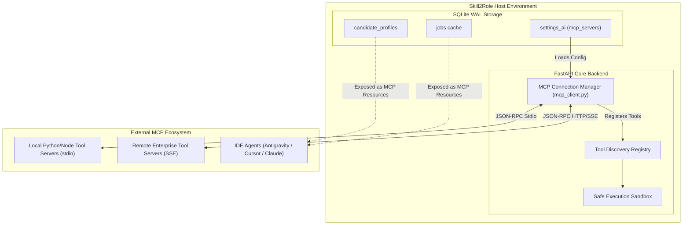

# Skill2Role: Model Context Protocol (MCP) Integration & Specification

**Document Purpose:** Ground-truth status, schema specification, client/server architecture, tool discovery protocols, and implementation blueprint for Model Context Protocol (MCP) connectivity in Skill2Role.  
**Current State (Stage 1):** Configuration persistence layer implemented in SQLite (`settings_ai.mcp_servers`) and REST API (`/api/settings/ai`). Full MCP runtime engine and external tool server execution scheduled for **Stage 4**.  
**Specification Version:** MCP Draft 2024-11-05 Compatibility  
**Last Updated:** October 2026  

---

## 1. Executive Summary & Implementation Status

| Component | Current Implementation (Stage 1) | Stage 4 Target Architecture |
| :--- | :--- | :--- |
| **MCP Server Registry** | Implemented. Serialized JSON array in SQLite `settings_ai` table. | Dedicated `mcp_connections` table with health checks. |
| **Settings REST API** | Implemented. `GET /api/settings/ai` and `POST /api/settings/ai` manage server lists. | Dynamic registration endpoints with live ping testing. |
| **Frontend Configuration UI** | Implemented in `ToolsView.jsx` and `SettingsView.jsx`. | Interactive tool invocation runner and parameter inspector. |
| **MCP Client Runtime** | **Planned (Stage 4).** | Python `mcp` SDK integration (`mcp.client.stdio` and `mcp.client.sse`). |
| **MCP Resource Server** | **Planned (Stage 4).** | Exposes candidate profiles and resume data to IDE agents (Cursor, Antigravity, Claude Desktop). |
| **External Tool Execution** | **Planned (Stage 4).** | Sandboxed tool execution with human-in-the-loop approval dialogs. |

> [!NOTE]
> In Stage 1, Skill2Role provides the database schema, models, and configuration surfaces for MCP servers. Active tool invocation and JSON-RPC streaming over Stdio/SSE are scheduled for **Stage 4** (Autonomous Agent Swarms & MCP Ecosystem).

---

## 2. MCP Server Configuration Schema

MCP servers are configured as a JSON array stored in `settings_ai.mcp_servers`. The system enforces the following JSON schema:

```json
[
  {
    "id": "ats-optimizer-server",
    "name": "Local ATS Analysis MCP Server",
    "transport": "stdio",
    "command": "python",
    "args": ["-m", "mcp_servers.ats_optimizer"],
    "env": {
      "LOG_LEVEL": "INFO"
    },
    "enabled": true
  },
  {
    "id": "remote-job-scout",
    "name": "Remote Job Scout MCP Server",
    "transport": "sse",
    "url": "https://mcp.skill2role.internal/sse",
    "apiKey": "mcp_sec_****",
    "enabled": false
  }
]
```

### Configuration Fields:
- `id` *(string, required)*: Unique slug identifier for the MCP server.
- `name` *(string, required)*: Human-readable display label.
- `transport` *(string, required)*: Communication transport: `"stdio"` (local process) or `"sse"` (remote HTTP streaming).
- `command` *(string, required for stdio)*: Executable command (e.g. `python`, `node`, `docker`).
- `args` *(array of strings, optional for stdio)*: Command-line arguments.
- `url` *(string, required for sse)*: Remote Server-Sent Events endpoint URL.
- `apiKey` *(string, optional)*: Bearer token or authorization key for remote servers.
- `enabled` *(boolean, required)*: Toggle switch to activate or pause the server connection.

---

## 3. Proposed Stage 4 MCP Architecture



---

## 4. MCP Tools & Capabilities (Stage 4 Target)

When Stage 4 is authorized and implemented, Skill2Role will expose and consume the following standardized MCP tools:

### 4.1 Exposed Resources (Skill2Role as MCP Server)
- `skill2role://profile/active`: Returns the current candidate's active persona, skills, experience, and contact details.
- `skill2role://jobs/recent`: Returns the last 50 discovered jobs matching the candidate's ATS threshold.
- `skill2role://jobs/analytics`: Returns 5-day application and discovery trajectory.

### 4.2 Consumed Tools (Skill2Role as MCP Client)
- `ats_keyword_gap(job_id, candidate_profile)`: Calculates semantic keyword overlap and missing hard/soft skills.
- `latex_resume_compile(resume_json, template_id)`: Generates ATS-optimized PDF resume via local LaTeX container.
- `company_enrichment(company_name)`: Queries Crunchbase/Clearbit MCP tools for funding, headcount, and tech stack insights.

---

## 5. Security & Safe Execution Boundaries

To prevent unauthorized file access, arbitrary code execution, or credential theft via rogue MCP tools:

1. **Process Isolation:** Local `stdio` MCP processes will execute in restricted child subprocesses with sanitized environment variables (excluding system master keys).
2. **Human Approval Gate:** Any tool requesting destructive actions (e.g., submitting an application form, purging records, or external file downloads) must trigger a visual confirmation prompt in the frontend UI.
3. **Network Whitelisting:** Remote SSE servers are restricted to HTTPS protocols with mandatory TLS certificate validation.
4. **Execution Timeouts:** Tool invocations will enforce a strict 30-second timeout to prevent hanging worker threads.

---

## 6. How to Configure an MCP Server (Current Procedure)

Until Stage 4 runtime execution is activated, developers can pre-configure MCP servers via the API:

```bash
curl -X POST http://localhost:5000/api/settings/ai \
  -H "Content-Type: application/json" \
  -d '{
    "mcp_servers": [
      {
        "id": "ats-tools",
        "name": "ATS Diagnostics MCP",
        "transport": "stdio",
        "command": "python",
        "args": ["-m", "mcp_servers.ats_tools"],
        "enabled": true
      }
    ]
  }'
```

Verify configured servers:
```bash
curl -X GET http://localhost:5000/api/settings/ai | jq .mcp_servers
```
