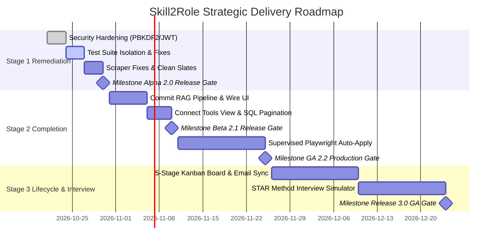

# Skill2Role: Master Strategic Roadmap & Release Milestones

**Document Version:** 2.0.0  
**Audit & Review Date:** October 21, 2026  
**Audited Repository State:** Commit working tree (`backend/`, `frontend/`, `docs/`)  
**Scope:** Staged product vision, release milestone gates, exit criteria, and release schedule estimates.  
**Cross-Reference:** See also [docs/stages/master-roadmap-stage1-to-final.md](file:///d:/JavaProjects/JobsOnly/docs/stages/master-roadmap-stage1-to-final.md) for detailed architectural blueprints.

---

> [!IMPORTANT]
> **Planning Estimates Notice:**  
> All milestone dates and effort projections are forward-looking planning estimates, not verified delivery commitments. Progression between milestones is contingent upon satisfying rigorous automated quality gates and security audits.

---

## 1. High-Level Release Timeline & Milestone Gates

---

## 2. Release Milestones & Mandatory Quality Gates

### Milestone 1: Alpha 2.0 (Security Hardening & Foundation Remediation)
- **Target Release State:** Internal Local Alpha
- **Core Deliverables:**
  - PBKDF2 password hashing with unique cryptographic salt per user.
  - Signed HS256 JWT tokens with 24-hour expiration replacing `tok_<user_id>` strings.
  - Isolated test harness (`DATABASE_PATH="test_jobs.db"`) preventing database wipeouts during `test_backend.py`.
  - Complete removal of silent mock fallbacks in `frontend/src/services/api.js`.
  - Repair or clean disabling of broken third-party platform scrapers (Naukri, LinkedIn).
- **Exit Criteria:**
  - 100% automated test pass rate across backend acceptance tests without touching `jobs.db`.
  - Zero critical (P0) or high (P1) security vulnerabilities remaining.

### Milestone 2: Beta 2.1 (Local RAG Studio & Compliance Gate)
- **Target Release State:** Closed Beta
- **Core Deliverables:**
  - Full tracking and commit of uncommitted Stage 2 RAG backend modules.
  - End-to-end integration between `GenerationView.jsx` and backend RAG endpoints (`/api/generation/*`).
  - Real-time sentence-level factual validation and visual diff highlights in the UI.
  - Dynamic JD keyword analysis replacing static 94% / 92% mockups in `ToolsView.jsx`.
  - Push pagination directly to SQLite `LIMIT` / `OFFSET`.
- **Exit Criteria:**
  - Candidate can ingest resume, analyze target JD, generate grounded draft, and export in 5 formats (HTML, Markdown, Plain Text, DOCX, JSON-LD).
  - Submission gate blocks 100% of synthetic hallucination test vectors.

### Milestone 3: Production GA 2.2 (Supervised Auto-Apply Automation)
- **Target Release State:** General Availability (Stage 2 Complete)
- **Core Deliverables:**
  - Headless browser automation worker (Playwright) supporting Greenhouse and Lever application forms.
  - Human-in-the-loop review queue requiring explicit confirmation before form submission.
  - Form field auto-filler with cryptographic compliance token validation.
  - Rate limiting, anti-CAPTCHA detection, and error backoff.
- **Exit Criteria:**
  - Verified successful real-world submission to test Greenhouse job board without human manual data entry.
  - Zero unverified or unapproved submissions allowed through compliance gate.

### Milestone 4: Release 3.0 (Lifecycle Tracking & Interview Preparation)
- **Target Release State:** Stage 3 Full Release
- **Core Deliverables:**
  - Drag-and-drop 5-stage Kanban application board (`Saved`, `Applied`, `Interviewing`, `Offered`, `Rejected`).
  - Automated application status tracking via IMAP email parser.
  - Interactive STAR-method behavioral interview coaching module with LLM audio/text feedback.
  - Conversion funnel analytics measuring application-to-interview ratios.

### Milestone 5: Release 4.0 (Autonomous Agent Swarms & MCP Ecosystem)
- **Target Release State:** Stage 4 Full Release
- **Core Deliverables:**
  - Model Context Protocol (MCP) server implementation for local tools.
  - Decentralized multi-agent coordination (Discovery Agent, Tailoring Agent, Submission Agent).
  - Background autonomous daemon operation with daily scheduled digests.

### Milestone 6: Release 5.0 (Enterprise Recruiter Scale)
- **Target Release State:** Stage 5 Full Release
- **Core Deliverables:**
  - Multi-tenant candidate pooling and organization roles.
  - Distributed Celery/Redis task queues for high-volume background crawling.
  - AES-256 field encryption for candidate PII.
  - SOC2 and GDPR compliance audit export endpoints.
