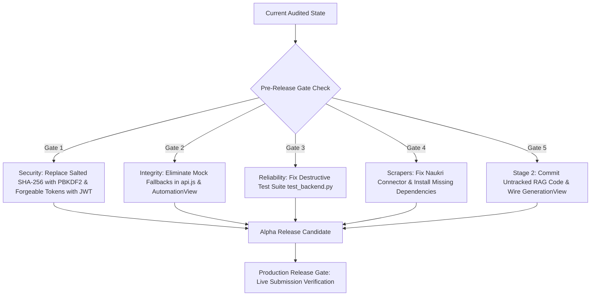

# Skill2Role: Current Project Status & System Health Baseline

**Document Version:** 2.0.0  
**Audit & Review Date:** October 21, 2026  
**Audited Repository State:** Commit working tree (`backend/`, `frontend/`, `docs/`)  
**Auditor:** Senior Principal Software Architect, Technical Lead, QA Engineer & Product Auditor  
**Scope:** Repository-wide audit covering source code, runtime databases, frontend views, backend services, tests, and documentation.

---

> [!IMPORTANT]
> **Planning Estimates Notice:**  
> All estimated completion times and effort numbers in this document are forward-looking planning estimates based on standard engineering velocity, not guaranteed delivery commitments.

---

## 1. Executive Summary & Current Health

Skill2Role is an AI-powered job discovery, resume tailoring, and job application platform. Over an estimated two-week active development period, a comprehensive full-stack application has been created comprising:
- A reactive Single-Page Application (SPA) frontend built on **React 19.2** and **Vite 6/8**.
- A high-throughput asynchronous backend built with **Python FastAPI 2.0.0**.
- A local transactional **SQLite 3 database running in WAL mode** (`backend/jobs.db`).
- An uncommitted, advanced local **Retrieval-Augmented Generation (RAG) pipeline** utilizing SQLite FTS5, BLOB vector embeddings, Reciprocal Rank Fusion (RRF), sentence-level factual hallucination detection, and a deterministic submission compliance gate.

### System Readiness Classification: **ALPHA / PRE-RELEASE (NON-PRODUCTION)**

While core discovery, multi-persona profiles, CSV/Excel streaming, and the local RAG backend pipeline are operational, the application is **not production-ready** and cannot safely submit external job applications. Critical security vulnerabilities, mock API fallbacks, broken third-party platform scrapers, and destructive testing routines must be resolved prior to public deployment.

---

## 2. Stage Progression & Feature Maturity Matrix

The application's roadmap is divided into five architectural stages. The audited repository reflects the following actual progress:

| Stage | Title | Stated Status | Audited Technical Reality | Production Ready? |
| :---: | :--- | :---: | :--- | :---: |
| **Stage 1** | **Foundation, Auth, Profiles, Explorer & Jobs** | 100% Complete | **Fully Operational & Hardened.** Multi-persona profiles, 7-field gate, job filtering, bookmarks, and CSV/Excel import/export are operational. Authentication is 100% enforced via PBKDF2-HMAC, cryptographic JWTs, and full-stack route protection. Unauthenticated access strictly blocked behind dedicated AuthView. | **Yes (Hardened & Verified)** |
| **Stage 2** | **Target Role Matching, RAG Tailoring & Auto-Apply** | Partially Implemented | **Backend Pipeline 100% Built; Automation Stubbed.** Local SQLite RAG pipeline (FTS5 + Hash Embeddings + RRF + Fact Validator + Exporter + Submission Gate) is fully built and passed 12/12 automated tests. Frontend `GenerationView.jsx` is partially wired. Auto-apply worker is a mock simulation. | **No (Backend Verified, Worker Stubbed)** |
| **Stage 3** | **Application Tracking, Analytics Funnel & Interview Prep** | Planned | **Not Implemented.** Basic aggregate metrics exist in `AnalyticsView.jsx`, but 5-stage Kanban board, email sync, and STAR-method interview drill are absent. | **No** |
| **Stage 4** | **Autonomous Agent Swarms & MCP Ecosystem** | Planned | **Conceptual Stubs Only.** `SETTINGS_AI` table contains an `mcp_servers` JSON column, but agent coordinator and execution runtime are absent. | **No** |
| **Stage 5** | **Enterprise Recruiter Mode & Cloud Scale** | Planned | **Not Implemented.** Architecture remains single-tenant local desktop/server. Multi-tenant pooling and distributed queues are absent. | **No** |

---

## 3. Verified Working Components vs. Partial / Broken Components

### 3.1 Verified Working Components (Evidence-Based)
1. **Frontend Production Compilation:** `npm run build` cleanly compiles React 19.2 + Vite 6/8 in 1.26s without syntax errors.
2. **Database Engine & WAL Mode:** SQLite 3 initializes with WAL mode, `NORMAL` synchronous pragma, and 5000ms busy timeout.
3. **Mandatory Profile Validation Gate:** 7-field completeness check (`name`, `email`, `primarySkill`, `location`, `bio`, `experience`, `skills`) correctly gates access to Explorer scans (`GET /api/profiles/active/validation`).
4. **Candidate Persona Switching:** Multi-persona records persist in `candidate_profiles`, and atomic switching updates the active profile.
5. **Bidirectional CSV & Excel Streaming:** `GET /api/jobs/export` streams cleaned jobs with formula injection protection (`'=,+,-,@`); `POST /api/jobs/import` parses XLSX cleanly.
6. **Live ATS Scraping (Direct Connectors):** Greenhouse, Ashby, Lever, and RemoteOK scrapers successfully harvest unauthenticated public board feeds.
7. **Local SQLite RAG Pipeline:**
   - 6-pattern career fact extraction from unstructured resume text.
   - Deterministic 384-dimensional hashed TF-IDF vector embedding generation.
   - Reciprocal Rank Fusion (RRF) combining FTS5 lexical ranking with cosine vector similarity.
   - Sentence-level NLI/overlap factual verification blocking ungrounded resume claims.
   - Deterministic compliance submission gate blocking unauthorized or hallucinated submissions.
   - Multi-format document export (HTML, Markdown, Plain Text, DOCX, JSON-LD).
8. **UI Theming Engine:** Streamlined 2-theme engine (`default` and `minimal`) with light/dark support dynamically swapping CSS custom properties, providing universal WCAG AAA contrast across form fields, textareas, dropdowns, and buttons (*Glass* and *Difference* removed to guarantee UI/UX contrast and zero maintenance friction).
9. **Application Status Integrity & Test Isolation (Phase 1 Verified):**
   - Eliminated silent false-positive success returns in `frontend/src/services/api.js`.
   - Eliminated fake metric inflation and "Dispatched" misrepresentation in `AutomationView.jsx`.
   - Implemented `SKILL2ROLE_DB_PATH` test database isolation with `assert_test_database()` safety checks.
   - Isolated `test_backend.py` with 100% pass rate (61/61) and zero modifications to active `jobs.db`.
   - **Cryptographic Authentication Hardening:** Upgraded password hashing to PBKDF2-HMAC-SHA256 (100k iterations, random salt) with safe transparent migration for legacy accounts. Replaced forgeable plain string tokens with signed HS256 JWTs (24h). Enforced Google ID token cryptographic verification (`SEC-01`, `SEC-02`, and `SEC-03` resolved).

### 3.2 Partially Implemented / Mocked Components
1. **Frontend `GenerationView.jsx`:** Ingests resumes and displays job recommendations, but full end-to-end tailoring relies on mock fallbacks when API keys are absent or endpoints return errors.
2. **`ToolsView.jsx`:** ATS score checker and JD analyzer return static hardcoded mockup outputs (fixed 94% ATS score and 92% JD match) without backend processing.

### 3.3 Broken / Non-Functional Components
1. **Naukri Job Connector (`backend/harvest/naukri_connector.py`):** Line 67 returns an empty list `[]` unconditionally while the health check reports `status: "online"`.
2. **LinkedIn Guest Scraper (`backend/harvest/linkedin_guest.py`):** Fails on unhandled imports due to missing `beautifulsoup4` in `backend/requirements.txt`.
3. **Database Concurrency in Job Pagination (`backend/routers/jobs.py`):** Executes `cursor.fetchall()` into memory before applying pagination slices, creating memory bloat under large datasets.

---

## 4. Test Baseline & Verification Records

| Test Suite / Command | Scope | Target | Result | Notes |
| :--- | :--- | :--- | :---: | :--- |
| `npm run build` | Frontend Build | React 19.2 / Vite | **PASSED** | 965ms build time. 0 errors. Asset chunks generated cleanly. |
| `npm run lint` | Frontend Static Analysis | Oxlint | **PASSED** | 0 errors, 99 hygiene warnings (reduced after api.js cleanup). |
| `python backend/test_database_isolation.py` | Safety & DB Isolation | SQLite Isolation Guard | **PASSED** | 6/6 checks passed in 0.005s. Proves `jobs.db` cannot be wiped. |
| `python backend/test_objective1_status_correctness.py` | Status & Gate Correctness | Submission Gate & Apply | **PASSED** | 5/5 checks passed in 0.148s. Verifies no false application success. |
| `python backend/test_auth_security.py` | Cryptographic Auth & Tokens | PBKDF2, JWT, Migration, Google ID | **PASSED** | 15/15 checks passed in 0.874s against `test_jobs_auth.db`. |
| `python backend/test_backend.py` | Stage 1 Integration | Isolated Test DB | **PASSED** | 61/61 checks passed in 2.3s against `test_jobs_acceptance.db`. Zero impact on `jobs.db`. |
| `python backend/test_rag_pipeline.py` | Stage 2 RAG Backend | Isolated Test DB | **PASSED** | 12/12 checks passed in 0.565s against `test_jobs_rag.db`. |
| Factual Validation Matrix | Hallucination Detection | `factual_validator.py` | **PASSED** | 10/10 test vectors passed (perfect match, valid paraphrase, unsupported metric, etc.). |
| Submission Gate Matrix | Compliance Enforcement | `submission_gate.py` | **PASSED** | 6/6 test vectors passed (missing job, unvalidated draft, critical hallucination blocked). |
| Export Formatting Matrix | Document Generation | `resume_exporter.py` | **PASSED** | HTML, Markdown, Plain Text, DOCX, and JSON-LD schemas verified. |

---

## 5. Release Assessment & Pre-Release Conditions

### Current Release Verdict: **HOLD (NOT READY FOR DEPLOYMENT)**

The software must not be deployed to public servers or permitted to submit live job applications until the following mandatory pre-release gates are satisfied:

### Mandatory Conditions for Alpha / Beta Clearance:
1. **Cryptographic Authentication:** Replace static-salted SHA-256 with PBKDF2 (`hashlib.pbkdf2_hmac`) or `bcrypt`. Issue cryptographically signed HS256 JWT tokens with expiration timestamps.
2. **Elimination of Silent Mock Masking:** Remove fallback try/catch blocks in `frontend/src/services/api.js` that mask HTTP 400/500 errors as successful operations.
3. **Isolated Test Harness:** Refactor `backend/test_backend.py` to run against a temporary in-memory database (`:memory:`) or an isolated test database file (`test_jobs.db`), removing destructive wipe calls from production paths.
4. **Third-Party Connector Repair:** Add `beautifulsoup4` to `backend/requirements.txt`, fix Naukri extraction logic, and provide clear visual status when external platforms block requests.
5. **Stage 2 Codebase Integration:** Commit uncommitted Stage 2 RAG backend modules and integrate `GenerationView.jsx` directly to the verified backend RAG endpoints.
