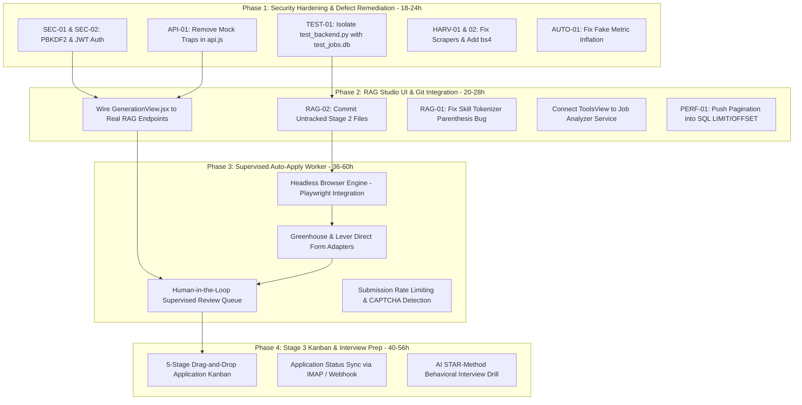

# Skill2Role: Prioritized Remaining Work & Implementation Backlog

**Document Version:** 2.0.0  
**Audit & Review Date:** October 21, 2026  
**Audited Repository State:** Commit working tree (`backend/`, `frontend/`, `docs/`)  
**Scope:** Actionable implementation tasks, dependency graph, acceptance criteria, and planning effort estimates.

---

> [!IMPORTANT]
> **Planning Estimates Notice:**  
> All effort hours, phase timelines, and resource estimates in this document represent forward-looking engineering planning estimates based on single-engineer full-stack velocity. They are **not** guaranteed delivery commitments. Actual delivery duration may vary based on external API stability, authentication constraints, and test execution environments.

---

## 1. Prioritized Implementation Roadmap & Dependency Flow

---

## 2. Phase 1: Security Hardening & Critical Defect Remediation
**Estimated Effort:** 18 – 24 Planning Hours  
**Primary Goal:** Eliminate all P0 vulnerabilities and P1 data falsification bugs; achieve clean test isolation.

### Task `REM-P1-01`: [COMPLETED] Cryptographic Authentication & 100% Full-Stack Authorization Gate (SEC-01, SEC-02, SEC-03, SEC-04)
- **Status:** **COMPLETED** (Verified October 21, 2026)
- **Module:** `backend/services/auth_service.py`, `backend/routers/auth.py`, `backend/main.py`, `backend/test_auth_security.py`, `frontend/src/services/api.js`, `frontend/src/components/AuthView.jsx`, `frontend/src/App.jsx`
- **Actions Completed:**
  1. Replaced static-salted SHA-256 with `hashlib.pbkdf2_hmac` using SHA-256, 100,000 iterations, and unique random 16-byte salt per user (`pbkdf2_sha256$<iter>$<salt>$<hash>`).
  2. Implemented transparent, safe password migration for existing legacy static-salted accounts upon successful login.
  3. Implemented PyJWT issuing and verifying cryptographically signed `HS256` tokens containing `sub`, `email`, `name`, `iat`, `exp` (24h), and `iss: "skill2role"`.
  4. Added `get_current_user` FastAPI dependency enforcing JWT signature, expiration, and user existence checks.
  5. Enforced router-level authorization by splitting `main.py` into `public_api_router` (`/api/health`, `/api/auth/*`) and `protected_api_router` (`dependencies=[Depends(get_current_user)]`). 100% of business endpoints now reject unauthenticated access with HTTP 401.
  6. Closed Google sign-in vulnerability (`SEC-03`) by requiring cryptographic Google ID token verification and rejecting raw email claims.
  7. Built `frontend/src/components/AuthView.jsx` & `AuthView.css` as a dedicated full-screen authentication gate with Sign In and Registration views.
  8. Removed mock guest user fallback (`usr_guest`) from `frontend/src/App.jsx`. Unauthenticated users cannot view the dashboard, radar, or navigation tabs; session expiration (HTTP 401) immediately returns them to `AuthView`.
  9. Added regression suite in `test_auth_security.py` verifying login, registration, migration, token expiry, tampering, Google validation, and unauthenticated 401 rejections across protected endpoints.
- **Acceptance Verified:**
  - 19/19 tests in `test_auth_security.py`, 6/6 in `test_database_isolation.py`, 6/6 in `test_objective1_status_correctness.py`, 12/12 in `test_rag_pipeline.py`, and 62/62 in `test_backend.py` (105/105 total) pass cleanly.
  - Production Vite frontend builds cleanly with 0 errors in 979ms.

### Task `REM-P1-02`: [COMPLETED] Isolate Backend Test Suite (TEST-01)
- **Status:** **COMPLETED** (Verified October 21, 2026)
- **Module:** `backend/test_backend.py`, `backend/database.py`, `backend/test_database_isolation.py`
- **Actions Completed:**
  1. Added dynamic DB path resolution via `get_db_path()` reading `SKILL2ROLE_DB_PATH` or `DATABASE_PATH` in `backend/database.py`.
  2. Implemented strict runtime guard `assert_test_database()` preventing test suite or data resets on active `jobs.db`.
  3. Refactored `test_backend.py` to use `test_jobs_acceptance.db` and Starlette `TestClient(app)`, with clean teardown.
  4. Added `test_database_isolation.py` with 6 regression tests validating safety assertions.
- **Acceptance Verified:**
  - `python test_backend.py` (61/61 passed) and `python test_database_isolation.py` (6/6 passed) execute in complete isolation; active `backend/jobs.db` remains 100% untouched with all 25 seeded Indian jobs.

### Task `REM-P1-03`: [COMPLETED] Remove Frontend Mock Fallback Traps (API-01)
- **Status:** **COMPLETED** (Verified October 21, 2026)
- **Module:** `frontend/src/services/api.js`, `frontend/src/App.jsx`
- **Actions Completed:**
  1. Refactored `apiFetch` in `api.js` to parse backend JSON error bodies and throw rich structured errors (`err.status`, `err.data`, `err.message`).
  2. Removed silent fallback return traps in `applyJob()` and `toggleJobMarker()` that faked successful job applications on network/HTTP failure.
  3. Removed duplicate method definitions (`updateAvatar`, `getGenerationJobs`, `generateTailoredResume`, `getExportJobsUrl`).
  4. Updated `App.jsx` `handleApply` to pass `{ user_approved: false }`, await backend confirmation, and display error toast notifications when server operations fail or are blocked.
- **Acceptance Verified:**
  - Network errors and HTTP 400/422 responses surface as real UI failure toasts instead of false success states.

### Task `REM-P1-04`: Repair Platform Harvesters (HARV-01 & HARV-02)
- **Module:** `backend/harvest/naukri_connector.py`, `backend/harvest/linkedin_guest.py`, `backend/requirements.txt`
- **Actions:**
  1. Add `beautifulsoup4>=4.12.0` to `backend/requirements.txt`.
  2. Implement valid job extraction logic in `naukri_connector.py` or set its health status to `disabled` if anti-bot protections require external proxy integration.
- **Acceptance Criteria:**
  - `python -c "import bs4"` executes cleanly in the backend environment.
  - Naukri connector health status matches its actual extraction capability.

### Task `REM-P1-05`: [COMPLETED] Eliminate Metric Inflation in Automation (AUTO-01)
- **Status:** **COMPLETED** (Verified October 21, 2026)
- **Module:** `frontend/src/components/AutomationView.jsx`
- **Actions Completed:**
  1. Removed `appliedCount` increment on catch blocks in `AutomationView.jsx`.
  2. Removed fake `+3` applied count increment on mock completion.
  3. Bound automation pipeline execution to real backend responses from `POST /api/jobs/{id}/apply` and `POST /api/jobs/{id}/pipeline`.
  4. Updated `handleRunAll` using `Promise.allSettled`, logging `[BLOCKED: CODE]` reasons without inflating metrics.
- **Acceptance Verified:**
  - `appliedCount` strictly mirrors verified database updates; failed or gated pipeline runs do not increment application counts.

---

## 3. Phase 2: Generation Studio Integration & RAG Stabilization
**Estimated Effort:** 20 – 28 Planning Hours  
**Primary Goal:** Fully wire the verified local RAG pipeline to the frontend UI and commit all Stage 2 code.

### Task `REM-P2-01`: Commit Stage 2 RAG Source Code (RAG-02)
- **Module:** Git Source Control
- **Actions:**
  1. Stage and commit `backend/services/*.py`, `backend/routers/generation.py`, and `backend/test_rag_pipeline.py`.
- **Acceptance Criteria:**
  - `git status` confirms all Stage 2 backend modules are tracked in source control.

### Task `REM-P2-02`: Wire `GenerationView.jsx` to Real RAG Endpoints
- **Module:** `frontend/src/components/GenerationView.jsx`, `frontend/src/services/api.js`
- **Actions:**
  1. Connect resume upload to `POST /api/generation/ingest`.
  2. Connect tailoring action to `POST /api/generation/tailor`.
  3. Display factual evidence matrix (grounded sentences vs. flagged sentences) in UI.
  4. Connect export dropdown to `POST /api/generation/export` supporting HTML, Markdown, DOCX.
- **Acceptance Criteria:**
  - Candidate sees real-time factual validation scores and diff highlights generated by the local SQLite RAG pipeline.

### Task `REM-P2-03`: Fix Career Facts Parenthesis Tokenizer Bug (RAG-01)
- **Module:** `backend/services/career_facts_service.py`
- **Actions:**
  1. Update regex splitting logic to treat parenthetical skill groups (e.g., `"AWS (ECS, RDS, S3)"`) as unified tokens.
- **Acceptance Criteria:**
  - `"AWS (ECS, RDS, S3)"` is extracted as a single competency rather than three fragmented tokens.

### Task `REM-P2-04`: Connect Career Tools View to Backend (TOOL-01)
- **Module:** `frontend/src/components/ToolsView.jsx`
- **Actions:**
  1. Replace hardcoded 94% / 92% mockups with calls to `POST /api/generation/analyze-job` and `POST /api/generation/validate`.
- **Acceptance Criteria:**
  - Uploading a JD produces a dynamic, evidence-based keyword match breakdown.

### Task `REM-P2-05`: Database-Level Pagination (PERF-01)
- **Module:** `backend/routers/jobs.py`
- **Actions:**
  1. Replace `fetchall()` slicing with SQL `LIMIT ? OFFSET ?` and `SELECT COUNT(*)`.
- **Acceptance Criteria:**
  - Memory usage remains constant even when job listings scale to tens of thousands of rows.

---

## 4. Phase 3: Real ATS Auto-Apply Worker & Supervised Submission Queue
**Estimated Effort:** 36 – 60 Planning Hours  
**Primary Goal:** Transform the auto-apply simulation stub into a working, supervised, human-in-the-loop application pipeline.

### Task `REM-P3-01`: Headless Browser Execution Engine
- **Module:** `backend/services/browser_worker.py`
- **Actions:**
  1. Integrate Playwright for Python with stealth plugins.
  2. Build session storage for cookies and anti-fingerprint profiles.
- **Acceptance Criteria:**
  - Headless browser can navigate to public Greenhouse and Lever job application forms.

### Task `REM-P3-02`: Human-in-the-Loop Supervised Review Queue
- **Module:** `frontend/src/components/AutomationView.jsx`, `backend/services/submission_gate.py`
- **Actions:**
  1. Present candidate with pre-filled form fields, tailored resume preview, and compliance token.
  2. Require explicit human confirmation ("Approve & Submit") before launching browser dispatch.
- **Acceptance Criteria:**
  - Zero external submissions occur without prior user confirmation and verified compliance token.

---

## 5. Phase 4: Stage 3 Application Tracking & Interview Simulator
**Estimated Effort:** 40 – 56 Planning Hours  
**Primary Goal:** Deliver full application lifecycle management and STAR-method behavioral interview coaching.

### Tasks:
1. `REM-P4-01`: 5-Stage Drag-and-Drop Application Kanban Board (`Saved`, `Applied`, `Interviewing`, `Offered`, `Rejected`).
2. `REM-P4-02`: Automated status sync via IMAP email header parser.
3. `REM-P4-03`: AI STAR-method behavioral interview drill with speech-to-text feedback.

---

## 6. Total Effort Summary Table

| Phase | Scope | Focus Area | Planning Effort | Target Stage Gate |
| :---: | :--- | :--- | :---: | :---: |
| **Phase 1** | Security & Defects | Auth, Test Isolation, Mock Removal | 18 – 24 Hours | Alpha Release Candidate |
| **Phase 2** | RAG Studio Integration | Full UI-RAG Wiring, Tools Tab, Git Commit | 20 – 28 Hours | Beta Release Candidate |
| **Phase 3** | Auto-Apply & Queue | Supervised Playwright Worker, Rate Limits | 36 – 60 Hours | Production v2.0 (Stage 2 Complete) |
| **Phase 4** | Tracking & Interview | Kanban Board, Email Sync, STAR Simulator | 40 – 56 Hours | Production v3.0 (Stage 3 Complete) |
| **Total** | **Phases 1 through 3 (Stage 2 Completion)** | **~74 – 112 Engineering Hours** | **Production Stage 2 GA** |
