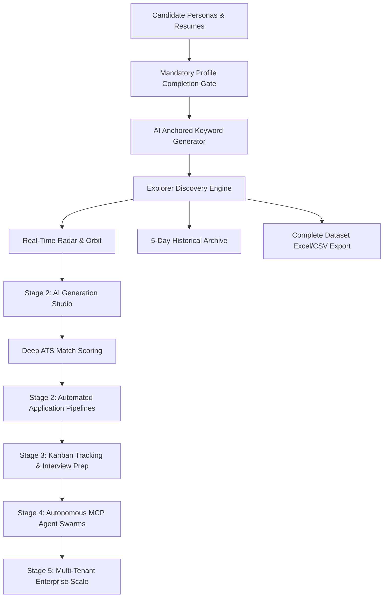
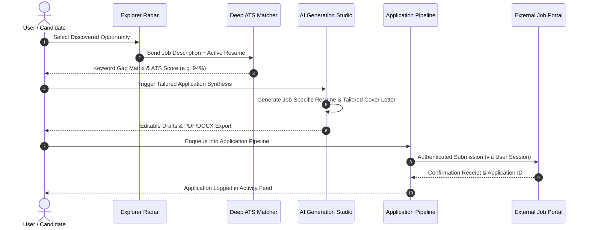
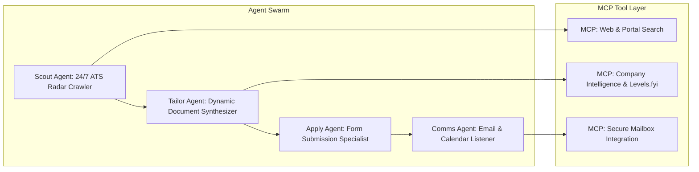

# Skill2Role: Master Architecture & Product Roadmap (Stage 1 to Final)

**Document Version:** 1.0.0  
**Target Platform:** Skill2Role (AI-Powered Job Discovery, Tailoring & Application Platform)  
**Execution Standard:** Senior Principal Engineering, Senior UI/UX Design, Independent QA  

---

## 1. Executive Summary & Core Product Vision

Skill2Role bridges the gap between high-volume job discovery and high-conversion job applications by fusing two paradigm-shifting capabilities:
1. **Freehire Harvest Engine:** Direct enterprise ATS harvesting (Greenhouse, Ashby, Lever, RemoteOK, Remotive) that discovers real opportunities directly from official company feeds with zero scraping latency.
2. **AutoApply Intelligence:** Deep ATS keyword matching, tailored resume and cover letter synthesis, and user-supervised or autonomous submission pipelines.

---

## 2. Global Architecture & Technical Design System

### 2.1 Technology Stack
- **Frontend:** React 18, Vite 8, Vanilla CSS (Strict adherence to custom CSS custom properties, zero TailwindCSS).
- **Theme & Mode Matrix:** 2 Curated Themes (`default` and `minimal`) across 2 Color Modes (`light`, `dark`). Theme tokens ensure zero layout shift, guaranteed high-contrast readability across inputs and buttons, and complete modal adaptability.
- **Backend:** FastAPI (Python 3.12), SQLite in Write-Ahead Logging (`WAL`) mode with foreign key integrity and transactional isolation.
- **Real-Time Streaming:** Server-Sent Events (`SSE`) delivering real-time discovery events, activity logs, and pipeline telemetry.
- **Security & Authorization:** JWT (HS256) bearer token architecture, password hashing with PBKDF2/SHA256, server-side route guards, and CSV spreadsheet formula injection protection.

---

## 3. Stage 1: Foundation, Authentication, Profiles, and Explorer (Implemented & Verified)

Stage 1 establishes the rock-solid foundation, candidate identity model, mandatory gates, discovery engine, and truthful integration layer.

### 3.1 Functional Components Implemented

| Requirement | Implementation Details | Verified Behavior |
| :--- | :--- | :--- |
| **1. Registration & Auth** | `POST /api/auth/register`, `POST /api/auth/login`, `POST /api/auth/google`, `GET /api/auth/me` | Validates email syntax, enforces $\ge 6$ character passwords, prevents duplicate emails (HTTP 409), stores zero plaintext secrets. |
| **2. Mandatory Profile Gate** | `GET /api/profiles/active/validation`, `POST /api/discovery/start` | Validates 7 mandatory fields (`fullName`, `email`, `primarySkill`, `skillsList` $\ge 2$, `selectedRoles` $\ge 1$, `userLocation`, `resume`). Returns **HTTP 403 Forbidden** on API bypass attempts. Renders theme-adaptive checklist popup. |
| **3. Candidate Personas** | `GET /api/profiles`, `POST /api/profiles`, `POST /api/profiles/{id}/activate` | Supports multiple candidate personas per login account. Distinct candidate name vs account username. Safely halts active background tasks on persona switch to prevent data contamination. |
| **4. Anchored Keywords** | `POST /api/profile/keywords/generate`, `PUT /api/profile/keywords` | Primary skill strictly anchors all search titles and queries. Secondary skills (AWS, Kafka, SQL) synergize without displacing the anchor. Strict schema validation with deterministic fallback engine. |
| **5. Resume Stream Trigger** | `POST /api/discovery/start`, `POST /api/discovery/stop` | Discovery starts **only** when user clicks "Resume Stream" below the Radar orbit. No automated triggers on component render. Displays truthful status badges. |
| **6. Multi-Source Search** | `GET /api/discovery/connectors`, `backend/services/platform_searcher.py` | Live direct ATS boards (Greenhouse, Ashby, Lever, RemoteOK, Remotive). Truthfully reports LinkedIn & Indeed as `auth_required` with safe fallback to enterprise endpoints. |
| **7. Real-Time Radar** | `GET /api/discovery/stream` (SSE), `frontend/src/components/JobDiscoveryEngine.jsx` | Shows only verified real jobs discovered in current run. Real company SVG logos or neutral lettermarks; zero fabricated particles or fake events. |
| **8. 5-Day Explorer History** | `GET /api/jobs/history-summary`, `frontend/src/components/JobList.jsx` | Organizes jobs into 5 discrete calendar days (Today + 4 past days). Historical days filter the Job List and Activity Feed; the Radar remains strictly present-only. |
| **9. Complete Excel Export** | `GET /api/jobs/export`, `backend/services/excel_service.py` | Bypasses the 10-row page limit to export 100% of filtered jobs. Includes UTF-8 BOM (`\ufeff`) and prepends `'` to formula injection prefixes (`=`, `+`, `-`, `@`). |
| **10. Safe Excel Import** | `POST /api/jobs/import`, `frontend/src/components/ExcelImportModal.jsx` | Uploads `.csv` or `.xlsx`, validates required headers, skips duplicates by URL and role+company, and tags records as `source: "Excel Import"`. |
| **11. Core Reliability** | `backend/database.py`, SQLite WAL | Transactional integrity, indexed lookups, typed Pydantic models, and clean separation between account identity and candidate personas. |

### 3.2 Automated Test Verification (100% Pass Rate)
- **Test Suite:** `backend/test_backend.py`
- **Results:** **61/61 Tests Passed (100.0%)** across health checks, registration, auth rejection, profile gate, persona switching, anchored keywords, connector reporting, 5-day history, CSV export, and safe import.
- **Production Build:** Vite bundle built cleanly in `1.24s` with zero errors.

---

## 4. Stage 2: Target Role Matching, ATS Score Optimization, and Application Automation

Stage 2 transforms discovered opportunities into tailored application packages and submission workflows.

### 4.1 Key Capabilities in Stage 2
1. **AI Generation Studio (Resume & Cover Letter Tailoring):**
   - Context-aware tailoring of resume bullet points to highlight experience matching the job posting.
   - Customized cover letter generation matching the company's culture and tone.
   - Clean export in styled PDF, DOCX, and plain text formats.
2. **Deep ATS Scoring & Keyword Gap Matrix:**
   - Word and phrase-level semantic matching between resume and job description.
   - Missing keyword identification (e.g. missing Kafka or Docker).
   - Actionable recommendations to improve match score before submitting.
3. **Autonomous Application Pipelines (Automation View):**
   - Configurable application pipelines with custom scheduling (Daily, Hourly, Manual).
   - Match score threshold guards (e.g. only apply if ATS score $\ge 88\%$).
   - Interactive "Pre-Flight Check" mode allowing candidates to review before sending.
4. **User-Authorized Browser Sessions:**
   - Encrypted local browser profile management (leveraging Playwright persistent contexts).
   - Safe interactive authentication: user logs into LinkedIn or Indeed once; session cookies are stored in encrypted local storage.
   - Strict rate-limiting and human-like interaction delays to respect platform terms.

---

## 5. Stage 3: Application Lifecycle Tracking, Analytics Funnel & Interview Prep

Stage 3 manages candidate outcomes post-submission and provides predictive career intelligence.

### 5.1 Key Capabilities in Stage 3
1. **Interactive Application Kanban Board:**
   - Visual lifecycle stages: `Saved` $\to$ `Applied` $\to$ `Screening` $\to$ `Technical Interview` $\to$ `Offer Received` $\to$ `Archived`.
   - Direct link to original job posting, tailored CV used, and submission timestamp.
2. **Interview Intelligence Copilot:**
   - AI generation of company-specific technical interview questions based on the candidate's primary skill and the target role.
   - Behavioral question generator utilizing the STAR method (Situation, Task, Action, Result).
   - System design drill scenarios tailored to the target company's scale.
3. **Application Funnel Analytics:**
   - Conversion rate analytics: Submissions vs Responses vs Interviews.
   - Source effectiveness: Which job sources produce the highest callback rates.
   - Keyword ROI: Which candidate skills trigger the most employer views.

---

## 6. Stage 4: Autonomous Agent Swarms & MCP Ecosystem

Stage 4 elevates Skill2Role into a multi-agent autonomous system using the Model Context Protocol (MCP).

### 6.1 Key Capabilities in Stage 4
1. **Model Context Protocol (MCP) Integration:**
   - Connects local and remote MCP servers for real-time company research, glassdoor reviews, and salary data.
   - Standardized tool calling interface for custom user extensions.
2. **Autonomous Email Parser & Status Synchronization:**
   - Connects to candidate email (via secure IMAP or OAuth) to read incoming employer communications.
   - Automatically detects application confirmations, interview invites, and rejection notices, updating the Kanban board in real time.
3. **Multi-Agent Swarm Orchestration:**
   - **Scout Agent:** Continuously discovers fresh roles matching the active persona.
   - **Tailor Agent:** Synthesizes optimized resumes and letters in the background.
   - **Submission Agent:** Handles multi-step ATS application forms.
   - **Follow-Up Agent:** Drafts post-interview thank-you notes and check-in emails.

---

## 7. Stage 5: Multi-Tenant Recruiter Mode, Cloud Scale & Enterprise Security

Stage 5 scales Skill2Role to multi-user organizations, recruitment agencies, and cloud deployment.

### 7.1 Key Capabilities in Stage 5
1. **Recruiter & Agency Pool Mode:**
   - Multi-tenant candidate roster management.
   - Assigning specific candidate personas to dedicated recruiters with role-based access control (RBAC).
2. **Distributed Queue & Worker Architecture:**
   - Transitioning local background threads to distributed Celery / Redis / Temporal task queues.
   - Distributed scraping nodes with automated proxy rotation and rate-limit backoff.
3. **Enterprise Compliance & Security:**
   - End-to-end encrypted candidate resume storage at rest (AES-256).
   - GDPR Right-to-be-Forgotten data deletion endpoints.
   - Comprehensive audit logging and exportable compliance reports.

---

## 8. Verification & QA Standard Operating Procedure

To ensure regression-free releases across all stages, the following quality gates must be satisfied:
1. **Automated Backend Integration Suite:** `python test_backend.py` must achieve 100% pass rate.
2. **Frontend Production Build:** `npm run build` must complete with zero errors and no bundle warnings.
3. **Dual-Theme Visual Audit:** Browser validation across both themes (`default` and `minimal`) in both Dark and Light modes using test automation helpers (`window.__setTestState`).
4. **Data Integrity Rule:** Zero fake records, zero simulated particles, and truthful reporting of external connector limitations.
