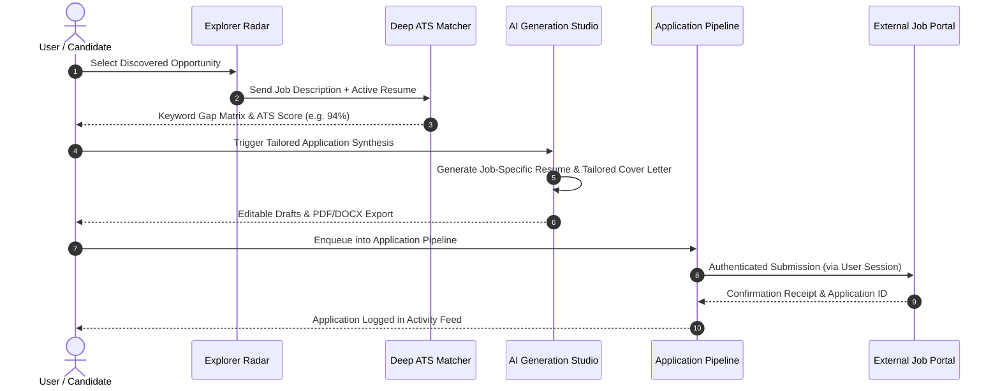

# Stage 2 Specification: Target Role Matching, ATS Optimization, and Application Automation

**Status:** Awaiting Explicit User Authorization  
**Execution Standard:** Senior Principal Engineering, Senior UI/UX Design, Independent QA  
**Prerequisite:** Stage 1 Foundation, Authentication, Profiles, and Explorer (Verified Complete)

---

## 1. Overview & Business Objectives

Stage 2 transforms discovered job postings into tailored application packages and managed submission pipelines:
- **AI Generation Studio (Resume & Cover Letter Studio):** Context-aware tailoring of CV bullets and cover letters matching the active candidate profile to target jobs.
- **Deep ATS Scoring & Keyword Gap Matrix:** Algorithmic comparison between candidate resume text and job description to identify match percentage and missing technical keywords.
- **Autonomous & Supervised Application Pipelines:** Configurable submission pipelines with pre-flight candidate review, scheduled batch runs, and auto-apply form filling.
- **Persistent User-Authorized Browser Sessions:** Safe, encrypted browser profiles (Playwright persistent contexts) allowing portal navigation on LinkedIn/Indeed without breaking platform terms or access controls.



---

## 2. Deep ATS Keyword Matcher & Gap Analysis

### 2.1 Scoring Algorithm
The ATS scoring engine computes a composite score:
$$\text{Score} = w_1 \cdot \text{PrimarySkillMatch} + w_2 \cdot \text{TechnicalTaxonomyOverlap} + w_3 \cdot \text{ExperienceSeniorityAlignment} + w_4 \cdot \text{SemanticSimilarity}$$

Where:
- $w_1 = 0.35$ (Core anchor: e.g. Java, Python)
- $w_2 = 0.30$ (Frameworks, databases, cloud, messaging)
- $w_3 = 0.20$ (Years of experience & title level: Senior, Staff, Lead)
- $w_4 = 0.15$ (Semantic vector / cosine similarity)

### 2.2 Keyword Gap Matrix Output
```json
{
  "atsScore": 92,
  "primarySkillMatched": true,
  "matchedSkills": ["Java", "Spring Boot", "PostgreSQL", "Kafka", "Docker"],
  "missingKeywords": ["AWS EKS", "Terraform", "OpenTelemetry"],
  "recommendations": [
    "Highlight experience deploying Java microservices to Kubernetes clusters.",
    "Mention observability tools (e.g. Prometheus, Grafana, OpenTelemetry) in your experience summary."
  ]
}
```

---

## 3. AI Generation Studio: Resumes & Cover Letters

### 3.1 Synthesis Engine
- **Input:** Parsed Active Candidate Profile + Target Job Posting Description.
- **Model Orchestration:** Supports local models (Ollama: `llama3`, `mistral`), cloud providers (OpenAI, Anthropic Claude, Google Gemini), and rule-based deterministic fallback.
- **Strict Guardrails:** Never invents fake degrees, certifications, or past employers. Rephrases real experience to highlight relevant technical keywords.

### 3.2 Output Artifacts
1. **Tailored Resume Markdown & PDF:** Clean, single-page or two-page professional CV matching target keywords.
2. **Personalized Cover Letter:** Explaining specific alignment with the company's mission and technical challenges.
3. **Elevator Pitch / Recruiter InMail:** A 3-sentence outreach message for hiring managers.

---

## 4. Application Automation Pipelines

### 4.1 Pipeline Configuration Schema
```sql
CREATE TABLE IF NOT EXISTS automation_pipelines (
    id TEXT PRIMARY KEY,
    profile_id TEXT NOT NULL,
    user_id TEXT NOT NULL,
    title TEXT NOT NULL,
    target_roles TEXT NOT NULL,
    platforms TEXT NOT NULL, -- JSON array: ['LinkedIn', 'Greenhouse', 'Lever']
    schedule TEXT NOT NULL,  -- 'Daily', 'Hourly', 'Manual'
    match_threshold INTEGER NOT NULL DEFAULT 85,
    mode TEXT NOT NULL DEFAULT 'Supervised', -- 'Supervised' (pre-flight check) or 'Autonomous'
    daily_limit INTEGER NOT NULL DEFAULT 25,
    active INTEGER DEFAULT 1,
    created_at INTEGER NOT NULL,
    updated_at INTEGER NOT NULL
);
CREATE INDEX IF NOT EXISTS idx_pipelines_profile ON automation_pipelines(profile_id);
```

### 4.2 Supervised vs Autonomous Modes
- **Supervised Mode (Recommended):** Pops up a pre-flight confirmation dialog showing the tailored CV, form fields, and target posting. Requires 1-click candidate approval before sending.
- **Autonomous Mode:** Runs in the background on scheduled intervals, submitting applications for any discovered posting exceeding the `match_threshold`, adhering strictly to `daily_limit` caps.

---

## 5. User-Authorized Browser Session Management

### 5.1 Playwright Persistent Session Architecture
- To interact with LinkedIn and Indeed legally and reliably without anti-bot blocks:
  1. The user launches an interactive, headful browser window to log in once.
  2. Playwright preserves storage state (`cookies`, `localStorage`) in encrypted local storage (`~/.skill2role/sessions/`).
  3. Subsequent automated actions use the user's authentic session without bypassing MFA, CAPTCHAs, or access controls.
  4. Humanized pacing: 3–7 second randomized delays between form interactions to avoid rate-limiting.

---

## 6. UI/UX Specifications for Stage 2

### 6.1 Views to Build & Enhance
1. **Generation View (`#generation`):**
   - Left Pane: Target Job Selector & Live ATS Score Dial.
   - Center Pane: Rich Markdown & WYSIWYG Resume/Cover Letter Editor.
   - Right Pane: Keyword Gap Matrix & 1-Click "Optimize with AI" buttons.
2. **Automation View (`#automation`):**
   - Active Pipelines Kanban: Pipeline Cards, Frequency Badges, Success Counters.
   - Application History Log: Table with Timestamp, Company, Role, ATS Score, Status (`Submitted`, `Pending Review`, `Failed`).
   - Pre-Flight Modal: Theme-adaptive dialog for reviewing tailored text before submission.

### 6.2 Theme & Mode Compatibility
All Stage 2 elements (editors, dials, pipeline cards, pre-flight dialogs) must strictly consume theme tokens:
- `--bg-card`, `--bg-surface`, `--text-primary`, `--text-secondary`, `--accent-primary`, `--border-color`.
- Zero hardcoded colors; zero Tailwind classes.

---

## 7. Stage 2 Acceptance Criteria

- [ ] ATS Matcher computes accurate match scores ($0–100\%$) against uploaded resumes and job descriptions.
- [ ] Generation Studio synthesizes job-specific resumes and cover letters with zero hallucinated credentials.
- [ ] Pipeline engine supports both Supervised (pre-flight approval) and Autonomous execution modes.
- [ ] User-authorized browser sessions store credentials securely and execute submissions with rate-limiting.
- [ ] Automated integration test suite covers ATS calculation, generation fallback, pipeline execution, and error handling.
