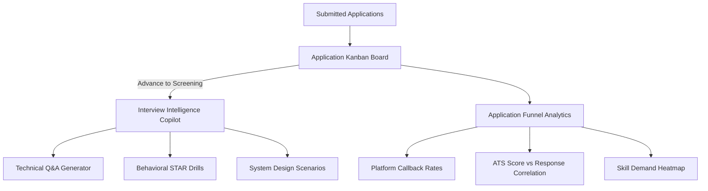

# Stage 3 Specification: Application Lifecycle Tracking, Analytics Funnel, and Interview Prep

**Status:** Future Stage  
**Execution Standard:** Senior Principal Engineering, Senior UI/UX Design, Independent QA  
**Prerequisite:** Stage 1 Foundation + Stage 2 Application Automation

---

## 1. Overview & Business Objectives

Stage 3 focuses on what happens after applications are submitted:
- **Application Lifecycle Kanban:** Centralized tracking across hiring stages (`Applied`, `Screening`, `Technical Interview`, `Offer`, `Archived`).
- **Interview Intelligence Copilot:** AI generator for company-specific technical interview questions, behavioral STAR stories, and system design challenges.
- **Application Funnel Analytics:** Quantitative conversion rates, response velocity per platform, and ATS score callback correlations.
- **Calendar & Reminder Engine:** Automated scheduling alerts for upcoming interviews and follow-up deadlines.



---

## 2. Interactive Application Lifecycle Kanban

### 2.1 Kanban States & Transitions
1. **Saved / Wishlist:** Discovered jobs saved for future consideration.
2. **Applied / Submitted:** Submissions executed via automation pipelines or manual applications.
3. **Screening / Recruiter Call:** Initial contact or phone screen scheduled.
4. **Technical Assessment / Interview:** Coding rounds, system design, take-homes.
5. **Final Round / Executive Interview:** Cultural alignment, hiring manager review.
6. **Offer Received:** Formal offer letters, compensation packages.
7. **Archived / Rejected:** Respectfully archived with feedback logging.

### 2.2 Data Model Schema
```sql
CREATE TABLE IF NOT EXISTS application_lifecycle (
    id TEXT PRIMARY KEY,
    job_id INTEGER NOT NULL,
    profile_id TEXT NOT NULL,
    user_id TEXT NOT NULL,
    company TEXT NOT NULL,
    role TEXT NOT NULL,
    status TEXT NOT NULL, -- 'saved', 'applied', 'screening', 'technical', 'final', 'offer', 'archived'
    applied_date INTEGER NOT NULL,
    interview_date INTEGER,
    salary_offered TEXT,
    notes TEXT,
    tailored_resume_path TEXT,
    tailored_cover_letter_path TEXT,
    updated_at INTEGER NOT NULL,
    FOREIGN KEY(job_id) REFERENCES jobs(id)
);
CREATE INDEX IF NOT EXISTS idx_lifecycle_status ON application_lifecycle(profile_id, status);
```

---

## 3. Interview Intelligence Copilot

### 3.1 Specialized Drills
1. **Technical Competency Drills:**
   - Ingests the candidate's primary skill (e.g. Java) and the company's tech stack (e.g. Spring Boot, Kafka, Distributed Systems).
   - Generates 15 challenging senior-level questions with model answers, edge-case discussion points, and performance pitfalls.
2. **Behavioral STAR Generator:**
   - Converts the candidate's real resume achievements into structured responses:
     - **S**ituation: Context and technical constraints.
     - **T**ask: Goal or problem to solve.
     - **A**ction: Candidate's direct technical contribution.
     - **R**esult: Quantified business impact (e.g., $40\%$ latency reduction).
3. **System Design Architecture Scenarios:**
   - Tailored to target company domain (e.g. Fintech: High-throughput ledger; Healthcare: HIPAA-compliant data lake; E-Commerce: Flash sale checkout).

---

## 4. Application Funnel Analytics (`#analytics`)

### 4.1 Key Performance Metrics
- **Conversion Velocity:** Average days from application submission to first interview response.
- **ATS Score Efficacy:** Correlation graph demonstrating response rate across score tiers ($70-80\%$, $80-90\%$, $90-100\%$).
- **Platform Success Ratio:** Conversion rate breakdown (Direct ATS vs LinkedIn vs Indeed vs Career Portals).
- **Skill Demand Heatmap:** Top in-demand secondary skills appearing across discovered jobs where the candidate currently has gaps.

---

## 5. UI/UX Specifications for Stage 3

### 5.1 Components
- **Kanban Board:** Smooth drag-and-drop column transitions with animated count pills.
- **Interview Prep Studio:** Clean collapsible question cards with "Reveal Ideal Answer" and "Practice Out Loud" prompts.
- **Analytics Dashboard:** Responsive SVG charts (Funnel Bar Charts, Response Time Lines, Match Score Distribution).
- **Full Theme Adaptation:** Respects `--bg-card`, `--accent-primary`, and color modes across all charts and cards.
