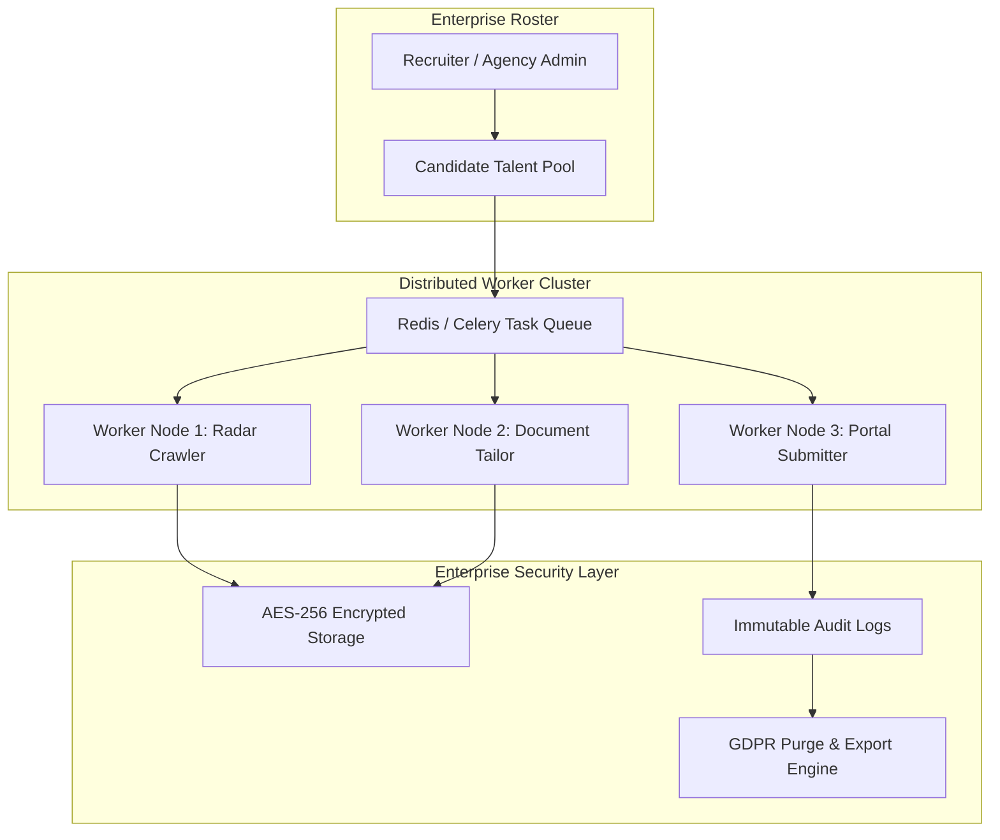

# Stage 5 Specification: Multi-Tenant Recruiter Mode, Cloud Scale, and Enterprise Security

**Status:** Final Stage  
**Execution Standard:** Senior Principal Engineering, Senior UI/UX Design, Independent QA  
**Prerequisite:** Stages 1 through 4

---

## 1. Overview & Business Objectives

Stage 5 scales Skill2Role from an individual power-user application into an enterprise-grade multi-tenant platform for recruitment agencies, career coaching academies, and enterprise talent placement teams:
- **Multi-Tenant Recruiter Roster:** Allows recruiters to manage pools of candidate personas, review discovery feeds across clients, and trigger bulk pipelines.
- **Distributed Queue Architecture:** Migrates local background tasks to distributed Celery / Redis / Temporal worker clusters with proxy rotation and rate-limit governance.
- **Enterprise Security & Compliance:** AES-256 encrypted resume storage at rest, SOC2/GDPR compliance endpoints, and role-based access control (RBAC).
- **Public API & Webhook Ecosystem:** REST APIs and webhooks allowing integration with external ATS platforms (Workday, Greenhouse, Taleo).



---

## 2. Multi-Tenant Recruiter Mode & RBAC

### 2.1 Role-Based Access Control Matrix
| Role | Capabilities | Data Isolation Scope |
| :--- | :--- | :--- |
| **Agency Admin** | Manage billing, team recruiters, API keys, global integrations | Organization-wide |
| **Senior Recruiter** | Create candidate personas, manage full application pipelines, view analytics | Assigned candidate pool |
| **Junior Recruiter** | Supervised applications only (pre-flight approval required) | Assigned candidate pool |
| **Candidate (Client)** | Read-only view of their own active applications and tailored CVs | Own persona only |

### 2.2 Multi-Tenant Organization Schema
```sql
CREATE TABLE IF NOT EXISTS organizations (
    id TEXT PRIMARY KEY,
    name TEXT NOT NULL,
    plan TEXT NOT NULL DEFAULT 'enterprise',
    created_at INTEGER NOT NULL
);

CREATE TABLE IF NOT EXISTS organization_members (
    organization_id TEXT NOT NULL,
    user_id TEXT NOT NULL,
    role TEXT NOT NULL, -- 'admin', 'recruiter', 'candidate'
    created_at INTEGER NOT NULL,
    PRIMARY KEY(organization_id, user_id)
);
```

---

## 3. Distributed Queue & Worker Cluster

### 3.1 Task Queue Architecture
- Replaces in-process threads with distributed workers:
  - **Task Queue:** Redis or RabbitMQ managed brokers.
  - **Worker Framework:** Celery or Temporal.io for durable workflows with automatic retry, backoff, and state checkpoints.
  - **Proxy Rotation:** Intelligent rotating residential proxies to distribute crawling load and prevent IP-level rate-limiting on public job feeds.

---

## 4. Enterprise Security, Privacy & Compliance

### 4.1 Encryption & Data Protection
- **Storage at Rest:** All uploaded resumes, tailored CVs, and credentials are encrypted using AES-256 (GCM mode) with per-organization cryptographic keys.
- **Secrets Vault:** API keys and persistent session cookies are stored in secure local vaults or HashiCorp Vault.

### 4.2 GDPR & Right-to-be-Forgotten Compliance
- Automated data purge endpoint:
  ```http
  DELETE /api/enterprise/candidate/{id}/purge
  ```
  Completely removes candidate records, resumes, tailored documents, and activity logs across all database tables with certified deletion confirmation.

---

## 5. Public API & Webhook Subsystem

### 5.1 Outbound Webhooks
Notifies external systems when critical events occur:
- `job.discovered`: Fired when a high-ATS-match opportunity is found.
- `application.submitted`: Fired when an application is sent with confirmation ID.
- `interview.scheduled`: Fired when an interview confirmation is parsed from email.

### 5.2 OpenAPI Documentation
Full Swagger / ReDoc API documentation hosted at `/api/docs` with typed schemas and code snippets for Python, Node.js, and cURL.
